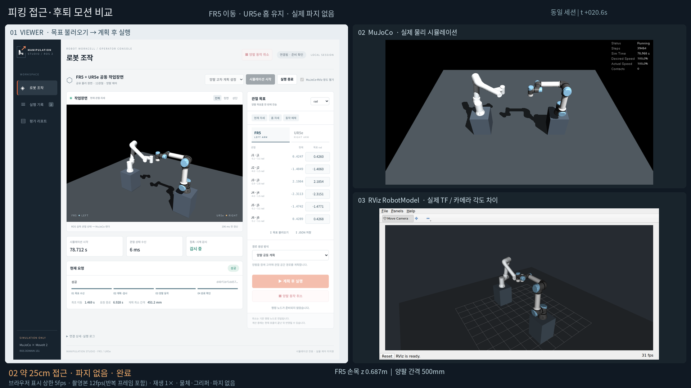

# MuJoCo·ROS 2 로봇 제어 시뮬레이션

로봇 시뮬레이션·동작 검증 개발 환경을 구축하기 위한 개인 개발 프로젝트입니다.
현재는 MuJoCo·ROS 2·MoveIt 2를 연결해 경로 계획·실행·충돌·상태 확인 기능을 개발하고 있습니다.

지향하는 환경은 다음 세 가지를 중심으로 합니다.

- **구성 요소의 교체:** 로봇·시뮬레이터·모션플랜·제어·뷰어를 분리해 교체·확장
- **설치 환경의 반영:** 현장별 설계파일과 배치를 시뮬레이션 작업환경에 반영
- **동작 검증:** 구성한 환경에서 계획·실행·충돌을 확인하고 결과를 기록

현재 개발의 초점은 **동작 검증**입니다.
FAIRINO FR5·FR10과 Universal Robots UR5e를 초기 기능 구현·검증 기준으로 사용하며,
기능을 보완한 뒤 지원 로봇의 종류를 확대할 계획입니다.
구성 요소의 범용 교체와 설계파일 기반 작업환경 구성은 후속 개발 목표입니다.

[**프로젝트 소개**](https://wannasleep3254.github.io/mujoco-ros2-manipulation/operator/project-overview-2026-10-23/index.html) ·
[**프로젝트 사이트**](https://wannasleep3254.github.io/mujoco-ros2-manipulation/) ·
[**검증·평가 이력**](https://wannasleep3254.github.io/mujoco-ros2-manipulation/#evaluations)

## 대표 시연

[](https://wannasleep3254.github.io/mujoco-ros2-manipulation/operator/project-overview-2026-10-23/index.html#validation)

**웹 조작 화면 → ROS 계획·실행 → MuJoCo 동작·상태 확인**을 같은 세션에서 촬영했습니다.
2026-10-22 기록의 FR5 이동·접근·후퇴·홈 복귀 4개 요청이며, 물체 파지는 포함하지 않습니다.
통합 화면에는 실행·취소·상태·오류·이력을 연결했습니다.
취소·복구 등의 별도 기능 검증은 [조작 화면 검증 기록](docs/operator_console.md#검증)에 정리했습니다.

## 직접 구현한 부분

MuJoCo는 물리·렌더링, ROS 2·ros2_control은 통신·궤적 제어,
MoveIt 2·OMPL은 모션 계획을 담당합니다.
MuJoCo와 ros2_control의 연동에는 [mujoco_ros2_control](https://github.com/ros-controls/mujoco_ros2_control)을 사용합니다.
이 프로젝트에서는 제조사 모델과 이 기반들을 연결하는 설정·생성·검사·실행·관측 기능을 구현하고, 필요한 런타임 패치를 관리합니다.

| 개발 항목 | 해결한 문제와 구현 | 코드·검증 근거 |
|---|---|---|
| 모델·설정 공통화 | 로봇별 차이를 YAML 프로필로 관리하고 관절 이름으로 연결합니다. 생성물 해시와 URDF·MJCF 순기구학 비교로 구성·변환 오류를 검사합니다. | [프로필](config/robots/) · [생성물 검사](src/mujoco_ros2_manipulation/model_build/integrity.py) · [변환 회귀 검사](tests/model/test_conversion.py) |
| 실행 결과 검증 | Action 성공과 관절 오차의 연속 충족을 함께 확인합니다. 실행 성공·목표 도달·취소·정상 종료를 구분해 기록합니다. | [상태 기반 판정](src/mujoco_ros2_manipulation/verification/ros_checks.py) · [검증 절차](docs/verification.md) · [요청·취소 기록](docs/motion_requests.md) |
| 양팔 동작·계산 개선 | 공간 경로를 유지한 출발 시점 조정과 중복 평가 재사용·후보 가지치기를 구현했습니다. 요청 ID로 계산과 실제 이동 구간을 나눠 계측합니다. | [출발 탐색](src/mujoco_ros2_manipulation/workcells/timing.py) · [요청 계측](src/mujoco_ros2_manipulation/workcells/request_trace.py) · [동일 입력 A/B](docs/search_optimization.md) |
| 오류 분석·실패 대응 | UI 자원 해제 순서를 수정하고 접촉·시계 이상 시 물리 고정과 양팔 취소를 연결했습니다. MoveIt 플러그인 수명 문제는 환경 한정 우회로 구분합니다. | [종료 패치](patches/mujoco_ros2_control-0.1.2-shutdown.patch) · [원인 분석·우회](docs/troubleshooting.md) · [물리 스텝 감시](native/step_monitor.hpp) · [접촉 대조 실행](docs/contact_comparison.md) |

출발 탐색 최적화는 고정 입력 6개 × 두 방식 × 5회 비교에서 선택 결과의 일치를 확인했습니다.
교차 입력의 탐색 중앙값 **1.975 → 1.537 s(wall)**는 오프라인 탐색 구간의 기존 결과입니다.
전체 지령 지연·일반 작업 성능이나 최소 우회 경로를 보장하는 수치는 아닙니다.
[측정 조건과 원본](https://wannasleep3254.github.io/mujoco-ros2-manipulation/2026-10-21-search-optimization/index.html)

## 계획부터 실행·관측까지

```text
웹 조작 화면 / CLI / RViz
  → 상시 명령 서버 또는 MoveIt 계획·실행
  → JointTrajectoryController (ros2_control)
  → mujoco_ros2_control → MuJoCo 관절 위치 서보
  → 관절 상태·TF·시계 → 웹 상태 표시 / RViz / 실행 기록
```

FR5·UR5e 공동 장면은 물리 세계·시계·전체 관절 상태 하나와 팔별 궤적 제어기를 사용합니다.
설정한 바닥·받침대의 고정 충돌 형상은 MuJoCo와 MoveIt이 공유합니다.
별도 웹 상태 렌더러는 수신 관절값을 표시하며 물리 적분이나 제어 명령 발행을 수행하지 않습니다.
[모델·장면·빌드 구조](docs/architecture.md) · [공동 장면](docs/workcells.md)

## 실행 시작하기

**새 PC에서는 [설치와 빌드 안내](docs/setup.md)를 먼저 진행해야 합니다.**
아래 명령은 의존성 설치, ROS 런타임 빌드와 모델 생성이 완료된 저장소 루트에서 실행합니다.

```bash
source ./manipulation_env.sh
python3 operator_console.py --domain 89 --port 8765
```

[로컬 조작 화면](http://127.0.0.1:8765/)에서
**시뮬레이션 시작 → 양팔 관절 목표 설정 → 계획 후 실행** 순서로 조작합니다.
현재 웹 조작 대상은 FR5·UR5e 공동 장면이며, MuJoCo·RViz·CLI도 사용할 수 있습니다.

단일 로봇은 준비된 환경에서 다음과 같이 실행합니다.

```bash
bash run_sim.sh robot:=fr5
```

`robot:=fr10` 또는 `robot:=ur5e`로 초기 테스트 모델을 선택할 수 있습니다.
현재 실행을 종료한 뒤 다른 모델을 시작합니다.
모델 설정·GUI 옵션·검증 명령·환경별 주의사항은 [상세 사용·검증 안내](docs/usage-and-validation.md)에 모았습니다.

## 현재 범위와 다음 목표

현재 확인한 범위는 제조사 모델 변환, 관절 위치 궤적 실행, 공동 장면,
계획·간격 검사, 접촉·시계 감시, 취소·완료·정상 종료와 기록입니다.
모델별 실행, 실제 GUI 동시 실행, 고정·근거리 입력 평가는 각 기록의 환경과 조건에서 확인했습니다.

- **현재 모델·장면:** FR5·FR10·UR5e, FR5·UR5e 공동 장면, 박스·원통 기반 고정 형상
- **현재 목표 입력:** 관절 목표 기반 계획·실행, 공동 계획 또는 출발 시점 조정
- **검증의 경계:** 전체 작업 공간 성공률·장시간 안정성·실제 파지·실물 제어는 미검증

후속 개발에서는 다음 범위를 다룹니다.

- 간격 조건에 따른 거부 원인과 지령 지연을 분리하고 일반 요청의 공간 재탐색 검증
- 설계파일·설치 배치 반영과 모듈 간 연결 방식 정리
- Pose/IK·TCP·그리퍼·물체 상태를 포함한 작업 기능과 테스트 모델 확대
- 실제 로봇의 실행·피드백·취소 계약과 접촉 작업의 제어 방식 검토

접촉 정지는 **공동 시뮬레이션의 물리 고정 기능**입니다.
실물 안전 인증·비상 정지 기능으로 검증한 결과는 아닙니다.
[현재 제작 상태와 남은 범위](docs/simulator_status.md)

## 주요 문서

| 자료 | 내용 |
|---|---|
| [설치와 빌드](docs/setup.md) | 새 PC 환경 준비, 고정 소스·의존성과 빌드 |
| [상세 사용·검증 안내](docs/usage-and-validation.md) | 모델별 명령·환경·실행 옵션·기존 검증과 비교 시연 |
| [패키지·장면·빌드 구조](docs/architecture.md) | 설정과 코드 경계, 공유 충돌 형상, 생성물과 CI |
| [현재 개발·검증 상태](docs/simulator_status.md) | 구현한 기능, 확인한 범위와 남은 작업 |
| [뷰어 개발 방향성](https://wannasleep3254.github.io/mujoco-ros2-manipulation/operator/viewer-direction-2026-10-22/index.html) | 조작·표시 구조, 기술 대안과 개선·평가 계획 |
| [모션플래닝 개발 방향성](https://wannasleep3254.github.io/mujoco-ros2-manipulation/operator/motion-planning-direction-2026-10-22/index.html) | 지연·우회 진단, 빈피킹·계획 기술·실물 확장 계획 |

제조사 모델·연동 패키지의 버전과 라이선스는 [출처 안내](docs/setup.md#소스-버전과-출처)에 기록했습니다.
