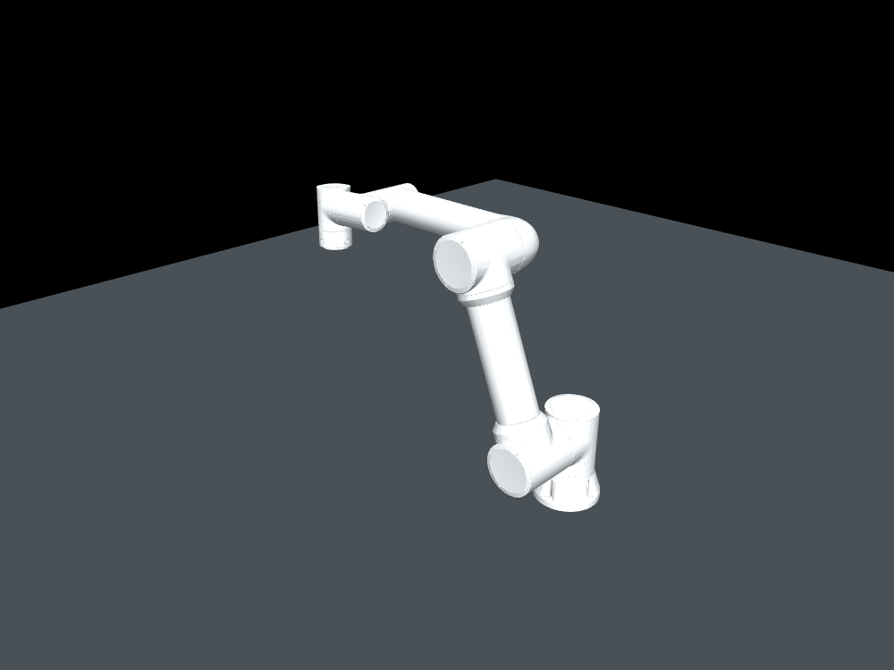
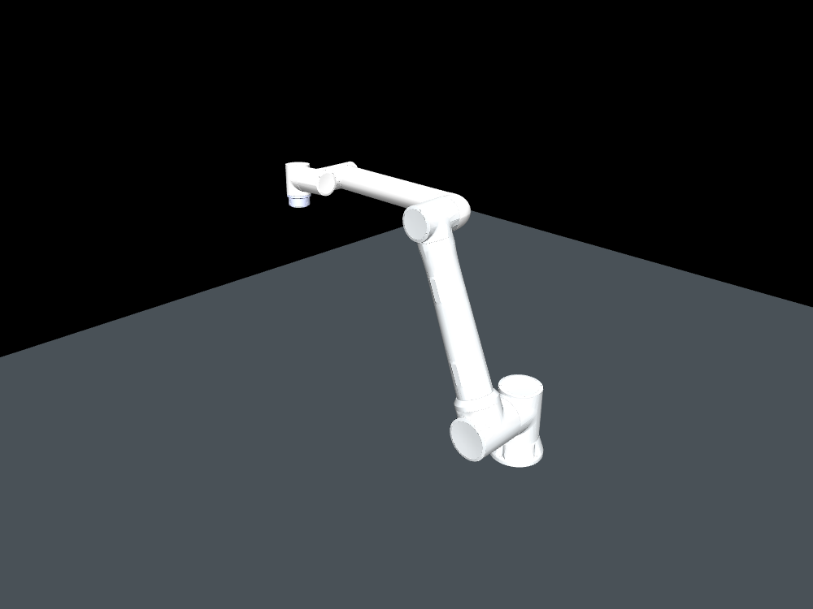
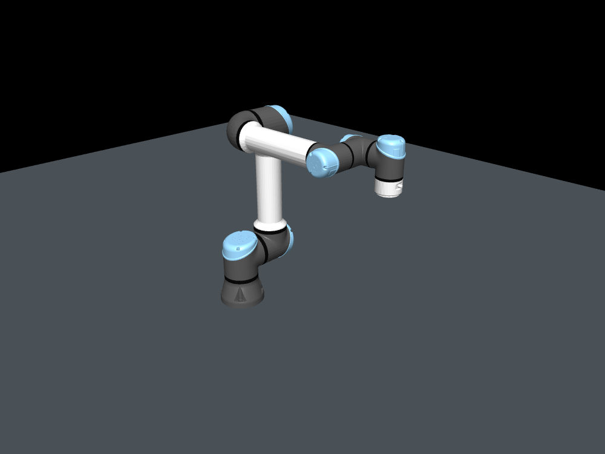
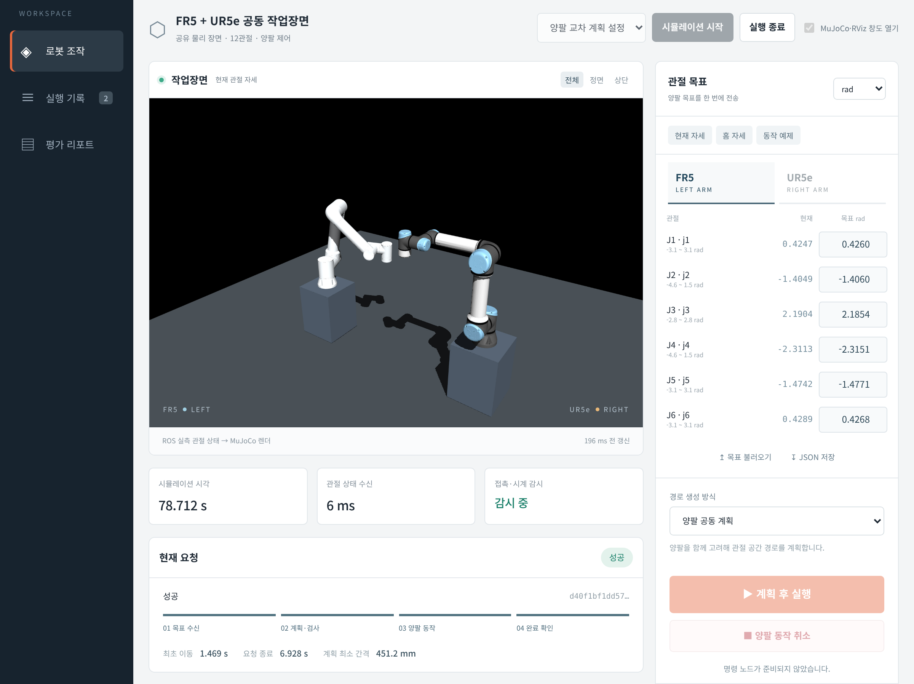
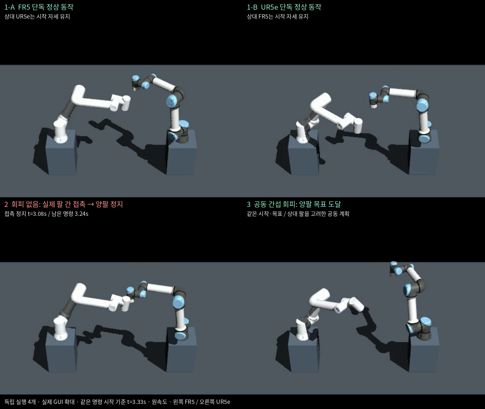

# mujoco-ros2-manipulation

MuJoCo와 ROS 2 Humble, ros2_control, MoveIt 2를 연결한 로봇팔 시뮬레이션 프로젝트입니다.
FAIRINO FR5·FR10과 Universal Robots UR5e를 공통 실행기로 선택하며,
제조사 모델 변환부터 경로 계획·실행, 관절 상태 기반 완료 확인과 정상 종료까지 검증했습니다.

FR5·UR5e 공동 장면과 상시 명령·취소·랜덤 평가도 제공합니다.
[전용 통합 조작 화면](docs/operator_console.md)에서 FR5·UR5e 공동 장면의 시작·목표 입력·계획 후 실행·양팔 취소·라이브 뷰·기록을 사용할 수 있습니다.
[시뮬레이터 제작 상태와 현재 PC 점검](docs/simulator_status.md)에 기능별 판정을 정리했습니다.

## 지원 모델과 실행 화면

| FAIRINO FR5 V6 | FAIRINO FR10 V6 | Universal Robots UR5e |
|---|---|---|
| [](docs/robots/fr5/README.md) | [](docs/robots/fr10/README.md) | [](docs/robots/ur5e/README.md) |
| [FR5 실행·설정·스크린샷](docs/robots/fr5/README.md) | [FR10 실행·설정·스크린샷](docs/robots/fr10/README.md) | [UR5e 실행·설정·스크린샷](docs/robots/ur5e/README.md) |

미리보기는 초기 자세의 MuJoCo Python 렌더입니다. 모델별로 카메라를 맞췄으며,
실물 크기 비교 기준은 아닙니다. 각 모델 문서에는 **실제 MuJoCo·RViz GUI 스크린샷**과
2026-10-07 촬영 실행의 검증 기록·이미지 해시를 함께 보관합니다.

| 모델 ID | 계획 그룹 | 궤적 제어기 | 계획 끝단 프레임 |
|---|---|---|---|
| `fr5` | `fairino5_v6_group` | `fairino5_controller` | `wrist3_link` |
| `fr10` | `fairino10_v6_group` | `fairino10_controller` | `wrist3_link` |
| `ur5e` | `ur5e_manipulator` | `ur5e_controller` | `tool0` |

FR5·FR10은 제조사 URDF/STL을, UR5e는 공식 Xacro와 DAE에서 변환한 시각 메시를 사용합니다.
UR5e의 `wrist_3_link → flange → tool0` 고정 좌표계를 보존했습니다.
FR5·FR10은 현재 `wrist3_link`를 끝단으로 사용하며 별도 도구 TCP는 아직 없습니다.
모델 차이와 출처는 [모델 자료 목록](docs/robots/README.md)에서 확인할 수 있습니다.

## 제어 구조

```text
MoveIt 2 / ROS 2 JointTrajectory 명령
  → JointTrajectoryController (ros2_control)
  → mujoco_ros2_control
  → MuJoCo 관절 위치 서보

관절 상태·좌표계·시뮬레이션 시간 → /joint_states · /tf · /tf_static · /clock
```

모델별 YAML 프로필에서 관절 이름·순서, 초기 자세, 서보 게인, ROS 이름과 검증 목표를 관리합니다.
같은 프로필로 MuJoCo 모델과 ROS 제어기 설정을 생성하고, 관절 이름으로 연결합니다.
위치 서보는 목표 각도에 따른 힘을 계산하므로 중력·관성·토크 제한의 영향을 받습니다.

## 전용 조작 화면

```bash
source ./manipulation_env.sh
python3 operator_console.py --domain 89 --port 8765
```

[로컬 화면](http://127.0.0.1:8765/)에서 **시뮬레이션 시작 → 목표 설정 → 계획 후 실행**을 사용합니다.
현재 대상은 FR5·UR5e 공동 장면입니다. 기존 MuJoCo·RViz·CLI도 계속 사용할 수 있습니다.
[사용 방법·연결·기록·검증 범위](docs/operator_console.md)

[현재 뷰어 상태와 접근·후퇴 비교 영상](https://wannasleep3254.github.io/mujoco-ros2-manipulation/operator/picking-comparison-2026-10-22/index.html) · [저장소 HTML](docs/operator/picking-comparison-2026-10-22/index.html)

실제 뷰어 조작·MuJoCo·RViz를 같은 세션에서 촬영했으며, 물체 파지는 제외합니다.

[](docs/operator/picking-comparison-2026-10-22/viewer-interface-focus.mp4)

HTML에서 **뷰어 조작 확대 / 뷰어·MuJoCo·RViz / 모션 확대 비교**를 전환할 수 있습니다. 첫 영상은 상단 제목·로고와 하단 안내·로그·푸터를 제외했으며 전체 UI 원본 영상도 연결했습니다. 뷰어는 DPR 2의 2400px 원본으로 재촬영했습니다.

## 빠른 실행

명령은 저장소 루트에서 실행합니다. **처음 설치하는 PC는 [설치와 빌드 안내](docs/setup.md)를 먼저 따릅니다.**
빌드와 모델 생성이 완료된 환경에서는 다음으로 FR5를 실행합니다.

```bash
.venv/bin/python prepare_robot.py --list
bash run_sim.sh robot:=fr5
```

MuJoCo와 RViz가 함께 열립니다. RViz의 MotionPlanning에서 모델의 계획 그룹을 선택하고,
현재 상태에서 목표 마커를 이동한 뒤 `Plan`으로 경로를 확인하고 `Execute`로 실행합니다.
관절 각도 단위는 rad입니다.

### 모델 변경과 실행 옵션

현재 launch를 **Ctrl+C로 종료한 뒤**, 원하는 모델의 명령 하나를 실행합니다.
기본 실행 도메인은 세 모델 모두 89입니다.

| 실행 대상 | 명령 |
|---|---|
| FR5 | `bash run_sim.sh robot:=fr5` |
| FR10 | `bash run_sim.sh robot:=fr10` |
| UR5e | `bash run_sim.sh robot:=ur5e` |
| GUI 없이 FR5 + MoveIt | `bash run_sim.sh robot:=fr5 gui:=false rviz:=false` |
| MuJoCo + ros2_control만 실행 | `bash run_sim.sh robot:=fr5 moveit:=false rviz:=false` |

추가 터미널에서 상태를 확인할 때는 같은 환경을 적용합니다.

```bash
source ./manipulation_env.sh
ros2 control list_controllers
ros2 topic echo /joint_states sensor_msgs/msg/JointState --once
```

### 모델 설정 수정

[FR5](config/robots/fr5.yaml), [FR10](config/robots/fr10.yaml),
[UR5e](config/robots/ur5e.yaml) 프로필을 수정한 뒤 해당 모델을 재생성합니다.
공통 제어 주기와 궤적 허용 오차는 [controller_defaults.yaml](config/controller_defaults.yaml)에 있습니다.

```bash
.venv/bin/python prepare_robot.py --robot ur5e
```

실행 중인 모델을 종료한 뒤 다시 실행해야 변경이 반영됩니다.
실행기와 검증기는 프로필·생성기·원본 입력·출력 해시가 다른 오래되거나 변경된 생성 모델을 차단합니다.
`use_sim_time`은 시간 기준을 정하는 옵션이며, 모델이나 실제 로봇을 선택하는 옵션은 아닙니다.

## 검증 환경과 결과

| 항목 | 확인한 환경 |
|---|---|
| OS / Python | Ubuntu 22.04.5 / Python 3.10 |
| ROS / MoveIt | ROS 2 Humble / MoveIt 2.5.10 |
| ROS 시뮬레이션 런타임 | MuJoCo 3.12.0 / mujoco_ros2_control 0.1.2 + 로컬 종료 패치 |
| 모델 변환·기준 렌더 | `.venv`의 MuJoCo 3.14.0 / NumPy 1.26.4 |
| 현재 PC (2026-10-21) | Intel i7-13700 / RTX 3050 6 GB / NVIDIA 580.178.04 / 데스크톱 OpenGL 4.6 |
| 갱신 주기 | 물리 0.002초 / ros2_control 100 Hz / 관절 상태 설정 50 Hz |

현재 PC의 양팔 실제 GUI·GPU 검증은 [최신 리포트](docs/reports/2026-10-21-search-optimization/index.html)에 보존했습니다.
아래 단일 모델의 2026-10-06~07 기록은 업그레이드 전 GTX 1050 Ti 환경의 결과입니다.
일반 MuJoCo 물리 계산은 CPU에서 수행하며 GPU는 렌더링에 사용합니다.
ROS 런타임과 Python MuJoCo는 별도로 구성했습니다.

| 모델 | 궤적·MoveIt·TF·시계 | 궤적 종료 후 최대 관절 오차 | 실행·종료 검증 기록 |
|---|---|---:|---|
| FR5 | 통과 | 약 0.0036 rad | [2026-10-06 기록](docs/fr5_shutdown_validation.json) |
| FR10 | 통과 | 약 0.0014 rad | [2026-10-06 기록](docs/fr10_validation.json) |
| UR5e | 통과 | 약 0.0041 rad | [2026-10-07 기록](docs/ur5e_validation.json) |

세 모델 모두 headless·GUI에서 동작을 확인하고 SIGINT 종료 및 MuJoCo 창 닫기 경로를 검사했습니다.
각 실행은 launch 코드 0, 잔류 프로세스 없음으로 종료했습니다.
창 닫기는 Trigger 서비스로 GUI와 같은 종료 경로를 실행한 검사입니다.
모델별 목표와 게인이 다르므로 관절 오차는 성능 순위로 해석하지 않습니다.

자동 검증은 시뮬레이션을 시작하고 궤적을 실행한 뒤 종료합니다.
ROS 검증에는 환경을 적용한 **시스템 Python**을 사용합니다.

```bash
source ./manipulation_env.sh
python3 verify_robot.py --robot fr5 --domain 92
```

완료 판정은 Action 성공 결과와 관절 오차 0.01 rad 미만의 상태 메시지 10개 연속 수신을 함께 확인합니다.
GUI·종료·구조 검사 명령과 결과 필드는 [검증 안내](docs/verification.md)에 정리했습니다.

## 문서 찾기

| 자료 | 내용 |
|---|---|
| [설치와 빌드](docs/setup.md) | 새 PC 준비, 고정 소스 버전, 생성 파일, 공통 코드 구성 |
| [의존성 업데이트](docs/dependency_updates.md) | Dependabot 주간 검사, ROS 호환성 제한, 보안 업데이트와 사본 반영 절차 |
| [모델별 자료](docs/robots/README.md) | FR5·FR10·UR5e 설정, 좌표계, 실제 GUI 스크린샷 |
| [전용 조작 화면](docs/operator_console.md) | 라이브 모델·양팔 목표·실행·취소·요청 기록과 리포트 |
| [뷰어 개발 방향성](docs/operator/viewer-direction-2026-10-22/index.html) | 통합 조작 화면 개발 사례·설계 근거, 렌더링 대안과 단계별 확장·검증 계획 |
| [모션플래닝 개발 방향성](docs/operator/motion-planning-direction-2026-10-22/index.html) | 빈피킹 우선·지연/우회 진단, 계획 기술 비교와 작업·실물 확장·검증 계획 |
| [시뮬레이터 제작 상태](docs/simulator_status.md) | 구동 확인 범위·현재 PC 실제 GUI·남은 기능·실행 방법 |
| [검증 안내](docs/verification.md) | 연속 명령의 완료 확인, 자동 검증, JSON·로그 해석 |
| [공개 성능 리포트](https://wannasleep3254.github.io/mujoco-ros2-manipulation/) | 브라우저에서 HTML 목록·지표·원본 데이터 열람 |
| [성능 리포트 목록](docs/reports/README.md) | 공통 HTML 목록·표준 JSON·CSV와 평가 이력 |
| [리포트 생성·게시](docs/reporting.md) | 공통 스키마·생성기·검증·CI 미리보기와 GitHub Pages 도입 검토 |
| [1차 성능평가 · 2026-10-21](docs/reports/2026-10-21-phase1/README.md) | HTML 리포트, 고정 사례 계산·동작 비교, 모션 플래닝 세션 대조와 랜덤 평가 설계 |
| [CI 통합·병합 경로](docs/integration.md) | 보호된 main에 CI와 선행 PR을 함께 반영하는 절차 |
| [문제 해결](docs/troubleshooting.md) | 종료 오류 원인·수정 근거, Python 환경과 모델 재생성 |
| [자료 촬영과 재생성](docs/robots/capture.md) | 기준 렌더, GUI 촬영, 출처·해시 갱신 |
| [초기 1관절 데모](docs/single_joint_demo.md) | Python 브리지, ROS 토픽 제어, rqt 및 초기 검증 기록 |
| [양팔 접촉 자동 정지](docs/contact_stop.md) | 접촉 후 물리 고정, 양팔 목표 취소·제어기 비활성화와 재시작 복구 |
| [공동 장면 접촉·GUI·성능](docs/workcell_diagnostics.md) | 매 물리 스텝 접촉 기록, 현재 PC의 headless·GUI 측정과 스크린샷 |
| [베이스·다중 로봇 작업계획](docs/plans/base_and_multi_robot.md) | 작업장면 설정 분리, 고정 베이스, FR5·UR5e 공동 제어와 단계별 완료 기준 |

## 패키지·빌드·작업장면

정식 구현은 `src/mujoco_ros2_manipulation`에 있고 루트 명령은 호환성을 유지합니다.
제조사/런타임 소스와 deb 잠금은 `config/build.yaml`, 로봇 설정은 `config/robots`,
설치 자세·고정 형상은 `config/scenes`에서 관리합니다.

```bash
python3 build_workspace.py --dry-run --robots fr5
.venv/bin/python prepare_robot.py --robot fr5 --scene pedestal
bash run_sim.sh robot:=fr5 scene:=pedestal
```

기본 바닥과 40cm 받침대 장면을 제공합니다. 같은 형상을 MuJoCo·ROS·MoveIt이 공유합니다.
[구조 설명](docs/architecture.md)에 설치형 CLI, 출력 경로, CI와 지원 범위를 정리했습니다.
[개발 검사](CONTRIBUTING.md) · [GitHub Actions](.github/workflows/ci.yml)

## 두 로봇 공동 실행

```bash
python3 build_workspace.py --component models --workcell fr5_ur5e
bash run_scene.sh workcell:=fr5_ur5e
# 독립 자동 검증
source ./manipulation_env.sh
python3 verify_scene.py --workcell fr5_ur5e --domain 93
```

물리 엔진·시계·전체 상태 하나와 팔별 궤적 제어기 두 개를 사용합니다.
[공동 작업장면 안내](docs/workcells.md)에 설치 자세·Action·계획 그룹·검사와 남은 범위를 정리했습니다.

### 충돌 때문에 멈췄는지 확인하는 대조 시연

[](docs/workcells/fr5_ur5e/contact_stop/comparison/comparison.mp4)

[나란히 비교 영상 (MP4, 11초)](docs/workcells/fr5_ur5e/contact_stop/comparison/comparison.mp4) ·
[재현 명령·검증 근거·CI 결과](docs/contact_comparison.md)

**동일한 8초 왕복 명령을 두 독립 실행에 적용**했습니다. 왼쪽은 약 2.01초에 기둥과 접촉해 양팔이 멈추고,
오른쪽은 장애물이 없어 남은 약 6초의 이동·복귀를 끝까지 수행합니다.
접촉 실행은 양팔 `CANCELED`, 대조군은 양팔 `SUCCEEDED`입니다. 명령 해시가 같고,
양팔 자동 정지 기능은 두 실행 모두 켜져 있습니다.

```bash
source ./manipulation_env.sh
python3 verify_contact_demo.py --gui
python3 verify_contact_demo.py --gui --control
```

첫 관절 목표는 ±2rad(약 115°)까지 4초 이동 후 4초 복귀입니다.
접촉 시점에 약 6초의 명령이 남아 있으므로 목표 도달과 접촉 정지를 구분할 수 있습니다.
기본 실행은 양팔 동시 정지를 유지합니다. 이전 단독 영상은 [과거 시연 기록](docs/contact_stop.md#고정-장애물-접촉-시연)에 보존합니다.

## 양팔 간섭: 정상·접촉·회피 비교

회피 대상은 **상대 로봇팔**입니다. 같은 장면·시작·목표와 고정된 궤적 묶음으로 세 조건을 비교합니다.

1. FR5·UR5e 각각 단독 정상 동작: 상대 팔은 시작 자세 유지.
2. 회피 없는 동시 동작: 손목 간 실제 접촉 후 양팔 자동 정지.
3. 공동 간섭 회피: 상대 팔을 고려해 경로·타이밍을 바꾸고 양팔 목표 도달.

[](docs/interference_comparison/comparison.mp4)

[비교 영상 — 약 24.38초](docs/interference_comparison/comparison.mp4) ·
[실행 방법·측정값·원본 보고서](docs/interference_comparison.md) ·
[첫 회피 시도 보존](docs/interference_avoidance.md)

무회피 실행은 명령이 **3.24초 남은 상태**에서 실제 손목 접촉으로 멈췄습니다.
단독 두 실행과 공동 회피는 접촉 없이 완료했습니다. 기존 위험 경로 전송 차단과 양팔 자동 정지는 유지합니다.

## 거리·경로 평가와 타이밍 조정

기존 공동 회피와 같은 시작·목표에서 **관절 경로를 유지하고 FR5 출발만 2.3초 지연**하는 방법을 비교했습니다.
이번 사례의 관절 누적 이동량은 24.69 → 2.02rad, 궤적 시간은 26.63 → 8.62초입니다.
두 방식 모두 양팔 성공·접촉 0이며, 새 실행의 수신 관절 자세에서 관측한 최소 간격은 약 30.6mm입니다.
거리 평가는 실제 ROS와 같은 MuJoCo 3.12.0을 사용합니다.

[](docs/timing_coordination/comparison.mp4)

[실제 비교 영상](docs/timing_coordination/comparison.mp4) ·
[정책·평가 지표·실행 방법·한계](docs/timing_coordination.md)

## 상시 명령과 지령 → 동작 계측

공동 시뮬레이션을 유지한 채 새로운 관절 목표를 받아 계획·검사·실행할 수 있습니다.
[상시 명령·취소·구간 계측](docs/motion_requests.md)은 같은 요청 ID로 계획 왕복과 서버 시간,
출발 탐색, 안전검사, Action 수락, 관측 최초 이동과 완료를 wall/sim 시계별로 기록합니다.
실패·취소·동시 요청 거부도 원본에 남깁니다.
[랜덤 목표 비교](docs/random_motion_benchmark.md)는 같은 목표·계산 예산과 실측 시작 기준으로 두 전략을 평가하고, 출발 탐색의 후보별 비용을 기록합니다.
[첫 비교 리포트](docs/reports/2026-10-21-random-motion/index.html)에 목표 5개 × 두 전략의 성공·계측 원본과 별도 교차 탐색의 비용 분해를 보존했습니다.

[출발 탐색 최적화](docs/search_optimization.md)는 중복 0초 평가와 최선 지연 이후의 후보를 제거합니다.
[동일 입력 A/B·실제 GUI 점검](docs/reports/2026-10-21-search-optimization/index.html)에서 6입력 × 두 방식 × 5회 결과가 정확히 일치했습니다.
교차 입력의 탐색 중앙값은 1.975→1.537wall초, 거리 호출은 39,917→30,784회였습니다.
이 수치는 오프라인 탐색 구간이며 지령→실제 동작 전체 지연과 구분합니다.

## 구현 범위와 다음 작업

현재 구현은 제조사 모델 변환, 위치 서보, ROS 2 궤적 제어, MoveIt 계획·실행과 종료 검증입니다.
서보 게인과 모터 감쇠는 예제 설정이며, 충돌 형상은 제조사 STL의 convex hull 근사입니다.
바닥·고정 받침대는 합성 URDF를 통해 MuJoCo와 MoveIt의 충돌 모델에 함께 반영합니다.

| 순서 | 다음 작업 |
|---|---|
| 완료 | 단일 로봇 작업장면 분리, 고정 받침대·공유 충돌 형상, 패키지 구조·CI·빌드 명세 통합 |
| 구현 | FR5·UR5e 공동 배치, 팔별 제어·계획, 관절 공간 공동 계획과 충돌 목표 거부 |
| 검증 추가 | [핵심 프로세스 크래시 시 자동 전체 종료](docs/process_crash.md) |
| 검증 추가 | [시계 누락·반복 감시와 양팔 위치 고정](docs/clock_stop.md) |
| 검증 추가 | [양팔 간섭 참조 경로 차단·공동 회피 전용 사례](docs/interference_avoidance.md) |
| 검증 추가 | 상시 명령·랜덤 평가·탐색 최적화 A/B·현재 PC 실제 GUI 점검 |
| 1 | 교차·장애물·큰 이동 평가와 실제 지령→동작 재측정 |
| 2 | 단일 모델의 화면 제어 확장, 크래시 후 위치 유지 검증, 끝단 Pose/IK 사례 |
| 3 | 단일·다중 로봇 성능 측정, 비교 표·영상 |
| 4 | 그리퍼·도구 TCP와 집기·이동·놓기 예제 |
| 5 | 접촉 조립·힘/순응 제어와 실제 로봇 연결 검토 |

[베이스·다중 로봇 작업계획](docs/plans/base_and_multi_robot.md)에 변경할 파일, 설정 초안, 검증 기준과 구현 순서를 정리했습니다.
고정 받침대, FR5·UR5e 공동 장면, 매 물리 스텝 접촉 감시·자동 정지와 고정 장애물 접촉 시연을 지원합니다.
CAD 메시 입력과 추가 작업·성능 비교는 후속 범위입니다.

실제 로봇 연결은 아직 검증하지 않았습니다.
제조사 모델과 연동 패키지의 고정 커밋·라이선스는 [출처 안내](docs/setup.md#소스-버전과-출처)에 기록했습니다.
