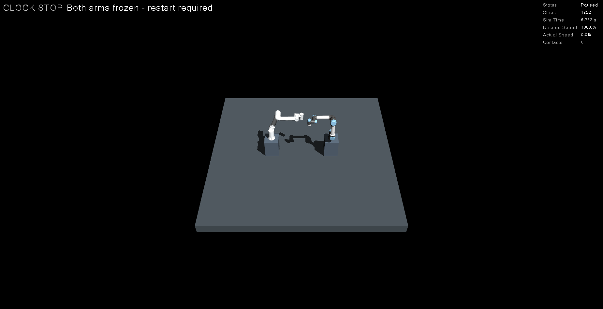

# 시계 정지 감시와 양팔 위치 고정 검증

[README](../README.md) · [공동 장면](workcells.md) · [접촉 정지](contact_stop.md) · [크래시 종료](process_crash.md)

## 동작

공동 작업장면의 네이티브 물리 루프가 `/clock` 수신값의 변화 여부를 감시합니다.
ROS 콜백은 다른 시각을 받았을 때 원자적 순번을 증가시키고, 물리 루프는
`std::chrono::steady_clock`으로 마지막 변화 이후 시간을 계산합니다.
ROS 시각으로 만든 타이머·서비스 완료를 기다려 정지를 판단하지 않습니다.

- 실행 중 시각 변화가 **1초** 없으면 `clock_stall`을 최초 정지 원인으로 기록합니다.
- 첫 시계 수신 전에는 **5초** 시작 유예를 적용합니다. 이 분기는 네이티브 정책 검사로 검증합니다.
- 실제 `sim_->run`이 false인 사용자 일시정지는 제외하고, 복귀 시 새 기한을 시작합니다.
- 기한 초과 시 다음 물리 적분 전에 전체 관절 자세를 저장·고정하고 속도·가속도·명령을 지웁니다.
  이후에는 물리 적분 없이 고정 상태와 증가하는 ROS 시계만 발행합니다.
- 시험용 시계 발행 오류는 고정 직후 해제합니다. 복구된 시계로 ROS 제어기 취소·비활성화를
  진행하더라도 물리 정지 래치는 해제되지 않으며, 다시 움직이려면 실행을 재시작해야 합니다.

기존 `/mujoco_ros2_control_node/contact_stop` Bool은 호환성을 위한 공동 정지 래치로 유지합니다.
원인은 새 `/mujoco_ros2_control_node/stop_reason` String과 `/workcell/contact_stop` JSON의
`reason`으로 구분합니다. 접촉은 `contact`, 시계 정지는 `clock_stall`입니다.
GUI는 각각 `CONTACT STOP`, `CLOCK STOP`으로 표시합니다.

## 실패 주입과 판정

```bash
source ./manipulation_env.sh
python3 verify_clock_stop.py --mode missing --domain 119
python3 verify_clock_stop.py --mode repeated --domain 120
# 설치된 패키지는 manipulation-verify-clock-stop으로 실행할 수도 있습니다.
```

`missing`은 실제 시계 발행을 끊고, `repeated`는 같은 시각만 계속 발행합니다.
네이티브 시험 서비스 `~/inject_test_clock_stall`은 실행별 검증 디렉터리가 있는
`clock_test:=missing/repeated` launch에서만 생성합니다. 일반 장면에는 노출하지 않으며
정상 공동 장면 검증에서 시험 서비스가 없는지도 검사합니다.
접촉 시험·고정 장애물 시연과 동시에 선택할 수 없습니다.

각 실행은 다음을 실제 ROS에서 확인합니다.

1. 1.5초 이상 의도한 일시정지로 시계가 멈춰도 정지가 래치되지 않고 복귀한다.
2. 양팔 모두 0.01rad 초과 이동·0.01rad/s 초과 속도를 관측하고, 두 목표가 미완료이며
   2초 초과 궤적이 남은 상태에서 주입한다.
3. 주입 시점 주변의 실제 시계 수신 기록에서 누락 간격 또는 같은 값의 반복을 확인한다.
   의도한 일시정지 구간은 이 증거에서 제외한다.
4. 벽시계 2초 안에 정지 래치를 관측한다. 검증기는 목표를 직접 취소하지 않는다.
   두 목표가 취소/중단되고 두 제어기가 inactive 상태가 되어야 한다.
5. 새 관절 상태 20회에서 속도 0·자세 변화 1e-12rad 미만을 확인한다.
   새 Action·직접 토픽·리셋·재개·단일 스텝·재주입을 거부/무시하고,
   외부 제어기 재활성화 시도 후에도 다시 비활성화되며 자세가 유지되어야 한다.
6. 종료 후 현재 실행 ID·감시 코드 해시를 가진 네이티브 전체 스텝 보고서에서
   `stop_reason=clock_stall`, 접촉 0, 래치 이후 추가 물리 적분 0을 확인한다.

공동 장면 CI에 두 실행을 추가했으며 기존 정상·접촉·A/B 대조·크래시 시험을 유지합니다.
원본 JSON·로그·physics.json은 성공·실패 모두 실행 artifact에 보관합니다.

## 로컬 실행 결과

2026-10-20, Ubuntu 22.04·ROS Humble, i7-13700·RTX 3050에서 측정했습니다.
아래는 검증 노드가 관측한 시간으로 네이티브 기한의 하드 실시간 보장을 뜻하지 않습니다.

| 주입 | 정지 관측까지 벽시계 | 양팔 Action 상태 | 접촉 스텝 | 정지 후 최대 이동 | 원본 |
|---|---:|---|---:|---:|---|
| `missing` | 1.003초 | [5, 5] | 0 | 0 rad | [결과](clock_stop/missing.json) |
| `repeated` | 1.006초 | [5, 5] | 0 | 0 rad | [결과](clock_stop/repeated.json) |

Action 상태 5는 CANCELED입니다. 두 실행 모두 일시정지 오탐 없음, 새 명령·리셋 차단,
재활성화 감시, ROS 시계 복구 후 위치 고정, 정상 종료·프로세스 잔류 없음을 통과했습니다.
[누락 로그](clock_stop/missing.txt) · [반복 로그](clock_stop/repeated.txt)

단위 검사 74개와 모델 검사 17개(총 91개), 네이티브 빌드·Python sdist/wheel 빌드,
정상 공동 동작과 일반/일시정지 접촉 정지 회귀 검증을 통과했습니다.

실제 NVIDIA MuJoCo·RViz GUI에서도 반복 시계 주입과 정상 종료를 통과했습니다.
[GUI 원본 결과](clock_stop/gui.json) · [RViz 화면](clock_stop/rviz.png)



## 적용 범위와 남은 항목

이 감시는 물리 루프와 운영체제가 계속 실행되는 상태에서 시계 발행·수신의 진행이 멈추는 경우를 대상으로 합니다.
물리 프로세스 자체의 크래시는 [전체 실행 종료 시험](process_crash.md)으로 구분합니다.
프로세스가 사라진 뒤의 위치 유지, 운영체제 전체 정지, 실제 하드웨어 제동은 이번 결과로 보장하지 않습니다.
영구적인 DDS 장애나 시계 발행 불능의 자동 복구는 구현하지 않았습니다. 물리 고정은 네이티브에서 유지하지만,
Action 종료·제어기 inactive의 ROS 확인은 통신과 시계가 복구되어야 진행할 수 있습니다.
단일 시계 발행자와 기본 실행 속도가 전제이며, 1초보다 긴 시계 갱신 간격을 의도한 극저속 실행은 별도 정책이 필요합니다.

양팔 개별 경로의 간섭을 공동 계획으로 우회하는 전용 사례와 크래시 후 위치 유지 검증은 남아 있습니다.
따라서 M5 전체 완료로 표시하지 않습니다.
