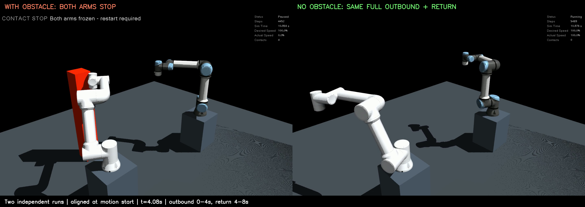
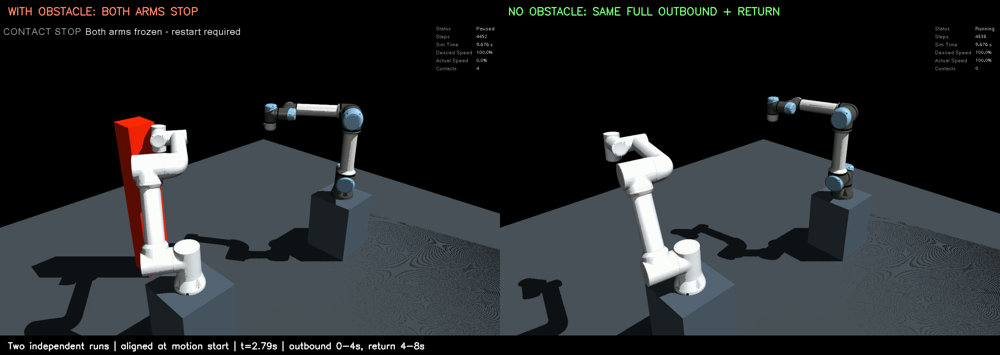
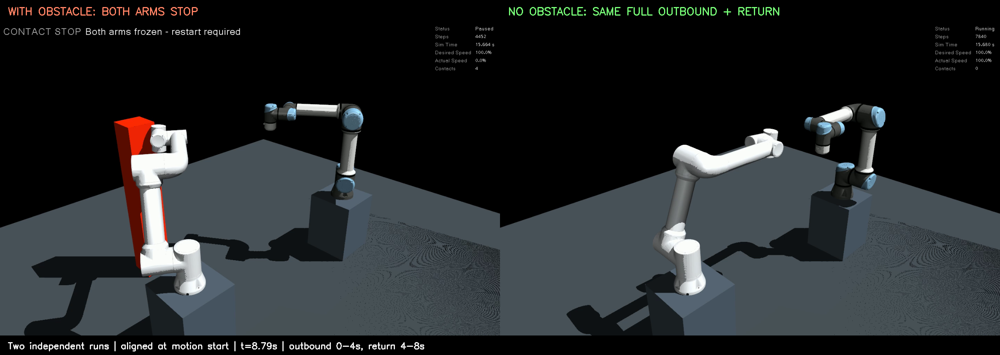

# 접촉 정지와 정상 모션 완료의 비교

[README](../README.md) · [양팔 정지 동작·복구](contact_stop.md) · [검증 안내](verification.md)

[](workcells/fr5_ur5e/contact_stop/comparison/comparison.mp4)

[비교 영상 재생·다운로드 (11초)](workcells/fr5_ur5e/contact_stop/comparison/comparison.mp4)

## 비교 방법과 확인 결과

두 독립 실행에서 같은 초기 자세·카메라·로봇 모델·전체 궤적 명령을 사용합니다.
왼쪽에만 고정 기둥이 있고, 오른쪽에서는 기둥을 제거합니다. **양팔 접촉 자동 정지는 두 실행 모두 활성화**돼 있습니다.
접촉한 FR5만 멈추고 같은 세계의 UR5e를 계속 움직이는 시험이 아닙니다.

전체 명령은 첫 관절 ±2rad까지 4초 이동하고 4초 동안 초기 자세로 복귀하는 8초 왕복입니다.
접촉 직전에 궤적이 끝나지 않도록 명령을 늘렸으며, 접촉 실행도 원래 명령 종료 시각 이후까지 관찰합니다.

| 항목 | 왼쪽: 장애물 있음 | 오른쪽: 장애물 없음 |
|---|---|---|
| 명령 | 동일 해시 `c2c5057a…`의 8초 왕복 | 같은 명령 |
| 초기·물리 정책 | 기둥 고정, 양팔 자동 정지 활성화 | 기둥만 제거, 양팔 자동 정지 활성화 |
| 접촉 시점 | 모션 시작 후 약 2.012초 | 접촉 0건 |
| 접촉 당시 남은 명령 | 약 5.988초 | 그 시간 동안 이동·복귀 계속 |
| 동작 | 약 56°에서 양팔 고정 | 약 114°까지 회전 후 초기 자세 복귀 |
| Action 결과 | 양쪽 CANCELED(5) | 양쪽 SUCCEEDED(4), 성공 코드 0 |
| 제어기 | 양쪽 inactive | 양쪽 active |
| 정지 이후 | 추가 적분 0회·관절 변화 0rad | 정상 물리 적분·모션 수행 |

| 접촉 이후: 대조군 계속 이동 | 대조군 바깥 목표 도달·복귀 시작 | 대조군 복귀 완료 |
|---|---|---|
| [](workcells/fr5_ur5e/contact_stop/comparison/interrupted.png) | [](workcells/fr5_ur5e/contact_stop/comparison/outbound.png) | [](workcells/fr5_ur5e/contact_stop/comparison/returned.png) |

영상 264프레임과 접촉 이후·바깥 목표·복귀 구간을 확인했습니다.
원본 창 녹화 두 개를 시작 시각에 맞춰 배치하고 크기·표제·시간축만 추가했습니다.
정지 화면을 편집으로 고정하거나 재생 속도를 바꾸지 않았고, 필요한 관찰 구간을 두 원본 녹화가 모두 포함해야 비교를 생성합니다.
영상의 `t=0`은 예약된 ROS 모션 시작입니다. 24fps 녹화와 관절 상태 시각을 이용한 정렬이므로 정밀 정지 지연 측정으로 사용하지 않습니다.

## 재현

저장소 루트에서 실행합니다. 녹화 폴더는 매번 새 이름을 사용합니다.
녹화에 필요한 시스템 OpenCV·Pillow·X11·H.264 환경은 [기존 안내](contact_stop.md#고정-장애물-접촉-시연)와 같습니다.

```bash
source ./manipulation_env.sh
python3 verify_contact_demo.py --domain 122 --gui --record-dir runtime/demos/contact-case
python3 verify_contact_demo.py --domain 123 --gui --control --record-dir runtime/demos/no-obstacle-case
python3 scripts/compare_contact_demo.py \
  --contact-report runtime/validation/visible_contact_fr5_ur5e_gui.json \
  --control-report runtime/validation/control_contact_fr5_ur5e_gui.json \
  --output-dir runtime/demos/comparison-case
```

CI와 GUI 없는 검사에서는 두 실행에서 `--gui --record-dir …`를 빼고,
비교기에 headless 보고서와 `--summary-only`를 전달합니다.
각 검증기는 모션·물리·정상 종료까지 확인하고 시뮬레이션을 종료합니다.
비교기는 같은 모델·실제 명령 해시, 자동 정지 활성화 유지, 충분한 잔여 명령,
접촉 실행의 취소·고정과 대조군의 성공·추가 이동·복귀·무접촉을 요구합니다.
명령이 다르거나 접촉 시점에 모션이 거의 끝났거나 대조군이 실패하면 비교도 실패합니다.
의도적인 시뮬레이션 접촉 시험이며 MoveIt 충돌 회피 계획·실제 하드웨어 시험과 구분합니다.

## 검증과 CI

로컬 전체 단위·모델 검사 82개 통과, 실패·건너뜀 0개입니다.
장애물/대조군 각각의 실제 ROS headless·GUI 실행과 비교 게이트가 통과했습니다.
CI 공동 장면에도 두 headless 실행과 비교 게이트를 추가했습니다.

이전 2차 시연 커밋 `d515e41`의 [CI 실행](https://github.com/WannaSleep3254/mujoco-ros2-manipulation/actions/runs/39366974900)은
Python과 ROS 5개 조합을 포함해 **6개 작업이 모두 통과**했습니다.
공동 장면 아티팩트에서도 정상 실행 두 회·일반/일시정지 접촉 주입·고정 장애물 접근 시험의 실제 통과 기록을 확인했습니다.
이 실행에는 실패 항목이 없었습니다. [확인 근거](workcells/fr5_ur5e/contact_stop/comparison/previous_ci.json)를 보관합니다.
이는 이전 커밋의 결과이며, 새 비교 커밋의 CI 결과는 PR 체크에서 별도로 확인합니다.

원본과 근거:

- [접촉 실행 원본 영상](workcells/fr5_ur5e/contact_stop/comparison/contact_source.mp4), [대조 실행 원본 영상](workcells/fr5_ur5e/contact_stop/comparison/control_source.mp4)
- [접촉 GUI 보고서](workcells/fr5_ur5e/contact_stop/comparison/contact_validation.json), [대조 GUI 보고서](workcells/fr5_ur5e/contact_stop/comparison/control_validation.json)
- [접촉 물리 기록](workcells/fr5_ur5e/contact_stop/comparison/contact_physics.json), [대조 물리 기록](workcells/fr5_ur5e/contact_stop/comparison/control_physics.json)
- [GUI 비교 결과·영상 정렬 정보](workcells/fr5_ur5e/contact_stop/comparison/comparison.json), [headless 비교 결과](workcells/fr5_ur5e/contact_stop/comparison/headless_comparison.json)
- [접촉 headless 결과](workcells/fr5_ur5e/contact_stop/comparison/contact_headless_validation.json), [대조 headless 결과](workcells/fr5_ur5e/contact_stop/comparison/control_headless_validation.json)
- [자료·소스 해시와 검사 결과](workcells/fr5_ur5e/contact_stop/comparison/assets.json)
