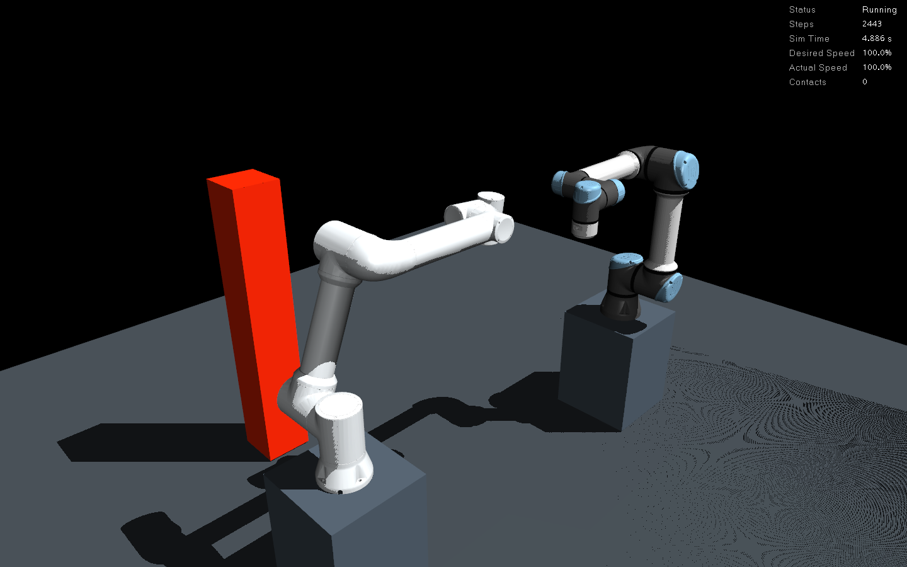
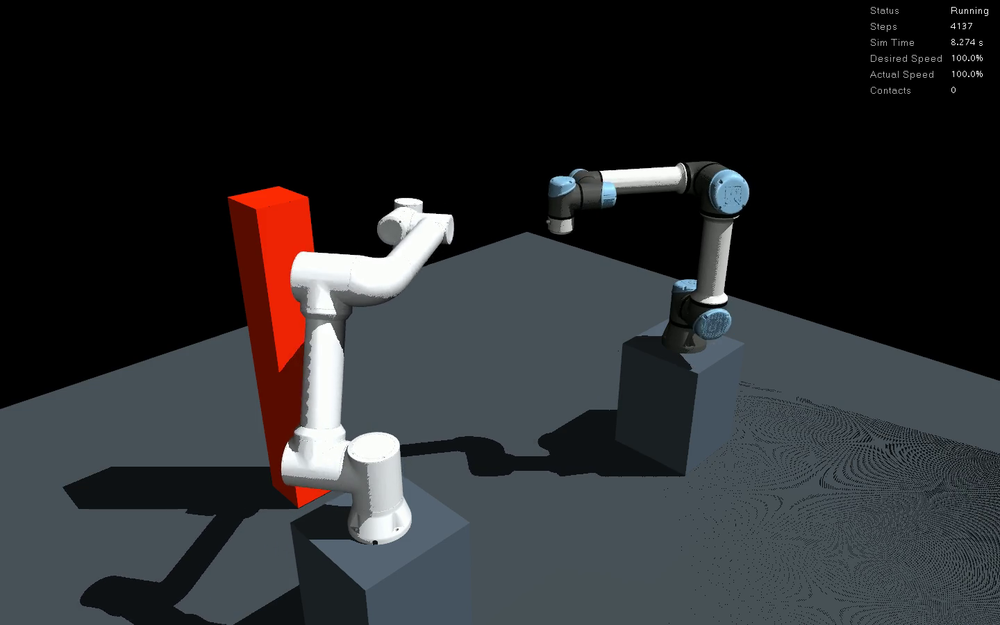
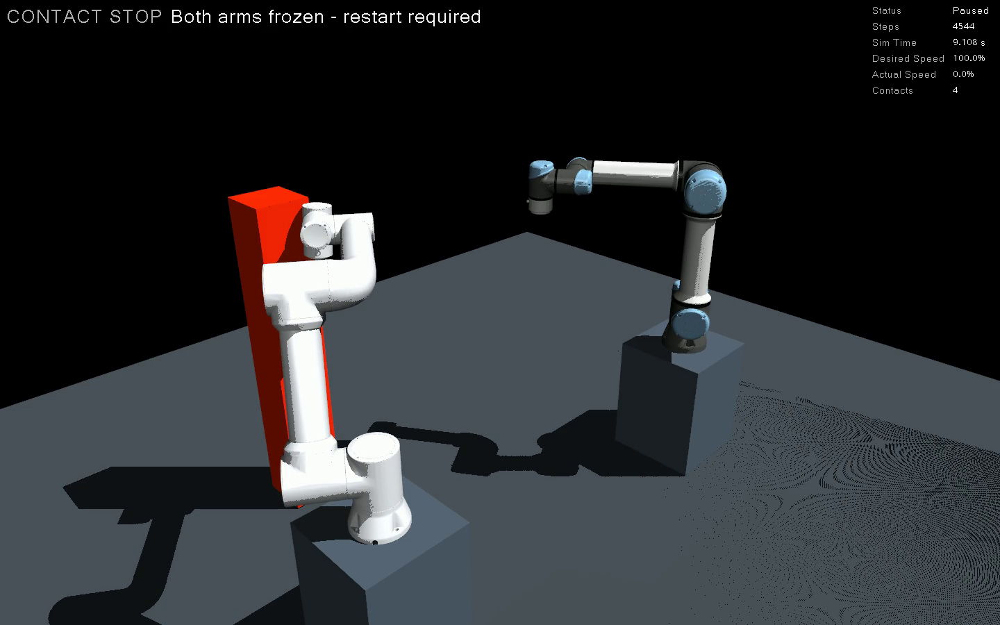
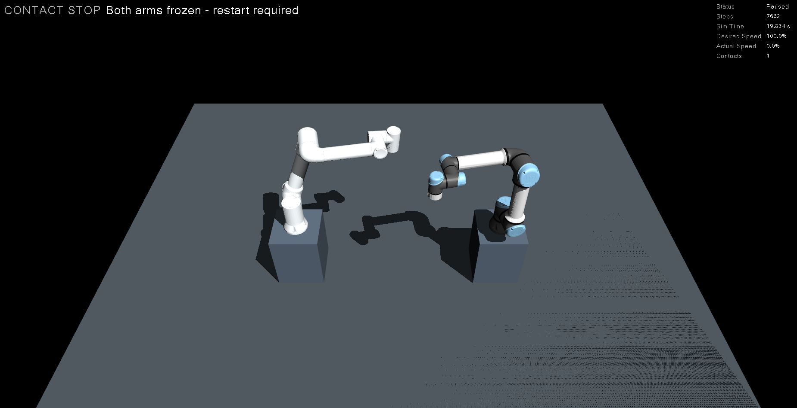
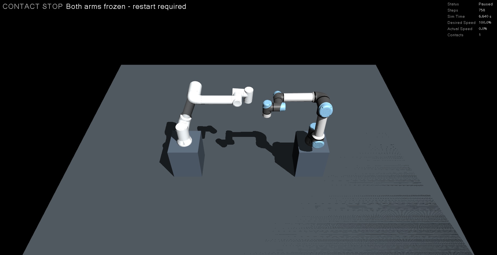

# 접촉 발생 시 양팔 자동 정지

[공동 작업 환경](workcells.md) · [접촉·성능 기록](workcell_diagnostics.md) · [확장 계획](plans/base_and_multi_robot.md)

FR5·UR5e 공동 작업 환경은 접촉이 검출되면 공통 물리 세계를 고정하고 양팔 제어기를 비활성화합니다.
`run_scene.sh`와 `workcell.launch.py`의 기본 동작입니다. 단일 로봇 실행 경로는 기존 설정을 유지합니다.
오래된 네이티브 런타임으로 보호 기능 없이 실행되지 않도록 시작 전에 감시 헤더의 빌드 해시를 확인합니다.

## 동작 순서

1. 네이티브 물리 스레드가 매 `mj_step` 직후 접촉 배열을 확인한다. 비활성 접촉 후보도 정지 대상이다.
2. 접촉이 있는 스텝이 끝나면 모든 qpos·mocap 자세를 저장하고 속도·명령·적용 외력을 0으로 만든다.
3. 이후에는 `mj_step`을 호출하지 않는다. 저장된 자세를 유지하고 ROS 시계·관절 상태만 계속 발행한다.
4. `/mujoco_ros2_control_node/contact_stop`에 정지 상태를 보존해 발행한다.
5. 별도 감시 노드가 양팔 Action의 실행 목표를 취소하고 두 제어기를 비활성화한다. 상태 발행기는 유지한다.
6. 외부에서 제어기를 다시 활성화해도 물리 고정은 유지되며, 감시 노드가 다시 비활성화한다.

물리 고정은 ROS 취소 응답을 기다리지 않습니다. 접촉 검출 스텝의 적분은 이미 수행됐으며,
그 뒤 추가 적분을 차단합니다. 현재 물리 간격은 0.002초입니다. 이는 시뮬레이션 시간의 스텝 단위 동작이며,
운영체제 지연을 포함한 벽시계 정지 시간이나 실제 모터의 제동 거리를 보장하지 않습니다.
실제 로봇의 안전 정지·비상정지 인터페이스는 별도로 구현해야 합니다.

시계만 멈추면 controller_manager도 시뮬레이션 시각을 기다릴 수 있으므로,
정지 후에는 물리 적분 없는 시계 틱을 사용합니다. GUI는 `CONTACT STOP`, `Paused`, 실제 속도 0%를 표시합니다.
`Sim Time`은 이때 ROS 시계이며 물리 적분이 계속된다는 의미가 아닙니다.
`physics.json`의 `steps`·`engine_steps`는 실제 적분만, `hold_ticks`는 정지 후 시계 틱만 집계합니다.
접촉 시의 `stop_step`은 최종 물리 스텝 수와 같아야 합니다.

모델의 충돌 제외·접촉 검출 알고리즘·시간 간격의 한계는 그대로 적용됩니다.
허용 접촉 목록은 없으며, 조립 등 의도적인 접촉을 허용하는 정책은 이 기능의 범위에 포함하지 않습니다.
공통 세계 전체를 고정하는 MuJoCo용 정지 기능입니다.

## 상태 확인과 복구

```bash
python3 build_workspace.py --workcell fr5_ur5e
bash run_scene.sh workcell:=fr5_ur5e

# 다른 터미널
source ./manipulation_env.sh
ros2 topic echo /workcell/contact_stop --once
ros2 control list_controllers
ros2 service call /mujoco_ros2_control_node/contact_stop_status std_srvs/srv/Trigger '{}'
```

상위 상태는 `waiting → ready → stopping → stopped`로 바뀝니다. `latched: true`는 한 번 접촉한 뒤 유지됩니다.
`stopped`에서는 양팔 제어기가 `inactive`, joint_state_broadcaster는 `active`입니다.
상태 서비스의 `success`는 네이티브 보호 기능의 활성 여부이고 `message`는 `ready` 또는 정지 유지 상태를 설명합니다.
이 서비스는 정지를 해제하지 않습니다.

정지 후 새 Action은 거부되며 직접 궤적 토픽·대기 명령도 물리 상태를 바꿀 수 없습니다.
초기화·재개·단일 스텝·free-joint 상태 변경 요청도 차단합니다. UI에서 초기화를 시도해도 저장된 자세를 복원합니다.
정지 해제 API는 없습니다. **접촉 원인을 제거하고 Ctrl+C로 종료한 뒤 시뮬레이션을 재시작**합니다.
감시 노드나 핵심 프로세스가 종료되면 launch 전체가 종료되도록 기존 종료 처리를 연결했습니다.

## 자동 시험

```bash
source ./manipulation_env.sh
python3 verify_contact_stop.py --domain 111
python3 verify_contact_stop.py --domain 112 --paused-contact
python3 verify_contact_stop.py --domain 114 --gui \
  --screenshot-dir docs/workcells/fr5_ur5e/contact_stop/images
```

설치형 명령은 `manipulation-verify-contact-stop`입니다.
실행별 임시 MJCF에만 시험용 구체를 추가합니다. 두 팔이 모두 움직임을 확인한 뒤 구체를 FR5 전완과 겹치게 하여
실제 접촉을 발생시킵니다. 관절을 충돌 자세로 순간 이동시키거나 접촉 플래그를 위조하지 않습니다.
일시정지 시험은 양팔 움직임 확인 후 일시정지하고, 접촉 장애물 배치와 단일 스텝을 실행합니다.
일반 실행에는 시험 물체·주입 서비스가 없고 원본 생성물도 변경하지 않습니다.

검증기는 양팔 목표를 보낸 후 직접 취소하지 않습니다. 자동 취소 결과와 양팔 비활성화를 관찰하고,
새 Action 거부·직접 토픽 무효화·초기화/재개/단일 스텝 거부·강제 재활성화 후 재비활성화·관절 위치 유지·정상 종료를 확인합니다.
CI는 정상 공동 동작 두 회와 접촉 정지의 일반/일시정지 두 경우를 실행합니다. 기대한 접촉 정지 시험의 성공은
`contact_stop_test: true`로 구분하며, 일반 자유 공간 검증은 계속 접촉 0건을 요구합니다.

소형 네이티브 시험은 ROS 없이도 접촉 후 추가 적분이 없고, 직접 qpos·속도·명령·시각을 바꾸어도
저장된 12관절 자세가 유지되는지 확인합니다. 모델/단위 시험에는 거짓 상태로 정지 해제 시도와 오래된 빌드 거부도 포함됩니다.

실행별 원본은 `runtime/validation/runs/<실행 ID>/`의 `result.json`, `physics.json`, `contact_test.xml`, `launch.log`에 있습니다.
주입 장애물과 네이티브 스텝의 해시·접촉 쌍·정지 시각·취소 결과는 [검증 기록](contact_stop_validation.json)에 보관합니다.
기존 종료/감시/정지 패치는 겹치는 부분이 있어도 전체 패치 순서와 현재 적용 단계를 검사한 뒤 나머지만 적용합니다.
반복 빌드·중간 단계에서 재개를 지원하며, 예상과 다른 사용자 수정은 덮어쓰지 않고 실패합니다.

## 고정 장애물 접촉 시연

이 절은 2차 시연 커밋 `d515e41`의 과거 기록입니다. 최신 실행은 [동일 명령의 장애물/무장애물 비교](contact_comparison.md)이며, 현재 CLI는 8초 왕복 명령을 사용합니다.

[영상 재생·다운로드 (MP4, 약 7.08초)](workcells/fr5_ur5e/contact_stop/visible_approach/approach-contact-stop.mp4)

| 초기 간격 | 이동·접근 | 접촉 후 자동 정지 |
|---|---|---|
| [](workcells/fr5_ur5e/contact_stop/visible_approach/before.png) | [](workcells/fr5_ur5e/contact_stop/visible_approach/approach.png) | [](workcells/fr5_ur5e/contact_stop/visible_approach/contact.png) |

실행 `20261020T035225.895962Z-17bf9e00`의 실제 MuJoCo 창을 1440×900, H.264, 24fps,
170프레임으로 녹화했습니다. 처음부터 고정된 붉은 기둥에 FR5 손목이 접근하고,
영상 약 4.17초(프레임 100)에 표면 접촉 후 `CONTACT STOP`·`Paused`·실제 속도 0%로 바뀝니다.
접촉 전후 프레임과 정지 유지 구간을 직접 확인했습니다. 재생 배속·합성 오버레이는 적용하지 않았습니다.

기둥은 `(-0.45, 0.72, 0.5)m` 위치의 `0.16×0.16×1.0m` 고정 상자이며,
MuJoCo의 충돌·시각 형상과 ROS/MoveIt URDF에 같은 크기·위치로 추가됩니다.
이 시연에는 mocap이나 접촉 주입 서비스가 없습니다. 로봇의 실제 적분·이동으로 접촉이 발생합니다.
기본 작업 환경과 과거 주입 시험은 그대로 두고, 별도 실행 디렉터리에 시연 모델만 생성합니다.

| 항목 | 최종 GUI 기록 |
|---|---|
| 첫 관절 명령 | FR5 +1.2rad, UR5e −1.2rad / 2.5초 |
| 접촉 전 실제 회전 | 약 0.984rad씩, 약 56.4° |
| 관측 첫 관절 최고 속도 | FR5 0.497rad/s, UR5e 0.472rad/s |
| 손목 경로 길이 재계산 | FR5 약 0.650m, UR5e 약 0.504m |
| 초기 로봇·장애물 최소 간격 재계산 | 약 0.437m, 초기 접촉 0개 |
| 실제 접촉 쌍 | `left_wrist2_link` ↔ `demo_obstacle` |
| 접촉 검출 | 첫 접촉 스텝 1회에 활성 접촉점 4개, 최대 겹침 약 0.21mm |
| 자동 정지 결과 | 양팔 Action CANCELED(5), 두 제어기 inactive, 새 목표 거부 |
| 정지 유지·종료 | 관절 변화 0rad, 추가 실제 적분 0회, 정상 종료·잔류 프로세스 없음 |

이전 영상의 명령 범위 0.25rad/5초와 비교해 범위는 4.8배, 명령 평균 속도는 약 9.6배입니다.
끝까지 실행하기 전에 접촉으로 정지하므로 실제 이동량은 명령 범위보다 작습니다.
손목 거리·초기 간격은 관절 상태를 Python MuJoCo 3.14.0으로 재계산한 값이고,
접촉·정지 판정의 원본은 ROS 런타임 MuJoCo 3.12.0의 물리 기록입니다.
관측 속도는 `/joint_states` 표본의 최고값으로 연속 시간 최대값을 보장하지 않습니다.

```bash
source ./manipulation_env.sh
# GUI 없이도 고정 장애물 접촉·양팔 취소·정지 유지·종료를 검사
python3 verify_contact_demo.py --domain 122
# 실제 창 실행 / 녹화 (아래 폴더가 이미 있으면 다른 이름 사용)
python3 verify_contact_demo.py --domain 123 --gui \
  --record-dir runtime/demos/my-contact-demo
```

설치형 명령은 `manipulation-demo-contact`입니다. 녹화 기능에만 시스템 Python의
OpenCV·Pillow와 X11 도구(`python3-opencv`, `python3-pil`, `x11-apps`, `x11-utils`)가 필요합니다.
X11 데스크톱과 H.264 인코더를 사용하며, RViz 계획 패널이 준비된 뒤 이 실행의 MuJoCo 창만 녹화합니다.
녹화 폴더는 덮어쓰지 않습니다. GUI는 NVIDIA OpenGL과 이 실행의 MuJoCo·RViz GPU 프로세스도 확인합니다.

이 검증기는 이동량 0.7rad 초과·관측 최고 속도 0.4rad/s 초과를 양팔 모두 요구하며,
주입 서비스 부재, 의도한 장애물과의 접촉 쌍, 얕은 표면 접촉, 양팔 자동 취소·정지 유지·새 목표 거부를 검사합니다.
MoveIt 충돌 회피를 우회하는 **시뮬레이션 전용 직접 궤적**으로 정지 기능을 시험합니다.
장애물 회피 성공 사례나 실제 로봇 제동 시험으로 해석하지 않습니다.

검증 자료: [GUI 원본 결과](workcells/fr5_ur5e/contact_stop/visible_approach/validation.json),
[headless 결과](workcells/fr5_ur5e/contact_stop/visible_approach/headless_validation.json),
[물리 기록](workcells/fr5_ur5e/contact_stop/visible_approach/physics.json),
[기구학 재계산](workcells/fr5_ur5e/contact_stop/visible_approach/geometry.json),
[프레임 검토](workcells/fr5_ur5e/contact_stop/visible_approach/frame_review.json),
[코드·자료 해시 및 회귀 실행 ID](workcells/fr5_ur5e/contact_stop/visible_approach/assets.json).
기구학은 `.venv/bin/python scripts/analyze_contact_demo.py --report <result.json> --fixture <contact_test.xml> --output <geometry.json>`으로 재계산합니다.

전체 단위·모델 검사 78개(실패·건너뜀 0개), 새 headless·GUI 시연,
기존 일반·일시정지 주입 시험과 정상 공동 제어 회귀 검사가 통과했습니다.
CI의 공동 작업 환경 작업에도 주입 없는 고정 장애물 접근 시험을 추가했습니다. GUI 녹화는 로컬 검사입니다.

## 시연 영상 (2026-10-20)

이 절은 **이전의 시각적 접촉이 없는 시험용 주입 기록**입니다. 최신 접근·접촉 영상은 위 절을 참고합니다.

[](workcells/fr5_ur5e/contact_stop/demo/contact-stop.mp4)

[MP4 재생·다운로드](workcells/fr5_ur5e/contact_stop/demo/contact-stop.mp4) ·
[원본 실행 결과](workcells/fr5_ur5e/contact_stop/demo/validation.json) ·
[물리 스텝 기록](workcells/fr5_ur5e/contact_stop/demo/physics.json) ·
[촬영 정보·파일 해시](workcells/fr5_ur5e/contact_stop/demo/assets.json)

원본 MuJoCo X11 창을 H.264, 1850×950, 12fps, 130프레임(약 10.83초)으로 녹화했습니다.
녹화 중인 실제 동작이며 재생 배속은 적용하지 않았습니다. 실행 ID는
`20261020T031658.580272Z-135895a1`, 구현 기준 커밋은 `1b3f92e`입니다.
영상의 왼쪽은 FR5, 오른쪽은 UR5e입니다.

| 구간 | 화면·검증 내용 |
|---|---|
| 초기 상태·이동 | 양팔 첫 관절에 +0.25rad를 5초에 실행하는 궤적 명령을 보냄 |
| 시험 접촉 | 두 첫 관절이 각각 약 +0.20rad(11.5°) 이동한 뒤 시험 구체를 FR5 전완과 겹치게 배치 |
| 자동 정지 | `CONTACT STOP`, `Paused`, 실제 속도 0%, 접촉 수 1 표시 |
| 정지 유지 | 양팔 Action 상태 CANCELED(5), 양팔 제어기 inactive, 관절 변화 0rad, 접촉 후 추가 적분 0회 |

**영상 130프레임과 정지 이미지 두 장을 재확인했으며, 눈으로 확인할 수 있는 접촉 장면은 없습니다.**
두 로봇은 서로 떨어져 있습니다. 영상 약 6.25초(프레임 75)에 `CONTACT STOP` 표시가 나타나지만,
장애물이 접근하거나 로봇 표면에 닿는 과정은 화면에 나타나지 않습니다.
시험 구체는 반지름 0.06m, 렌더 그룹 3이며 주입 서비스가 전완 내부로 순간 배치합니다.
따라서 이 자료의 범위는 **시험용 접촉 주입 후 정지 상태 기록**입니다.
물리 기록에는 `left_forearm_link`와 `contact_stop_test_probe` 쌍 1건이 있지만,
이는 화면에서 접촉을 확인했다는 근거가 아닙니다. 로봇끼리 충돌한 기록도 아닙니다.
큰 이동, 화면에서 식별되는 장애물의 접근·표면 접촉, 접촉 전후 확대·표시를 갖춘 시연은 아직 없습니다.
이번 자료 추가에서는 궤적·충돌 형상·자동 정지 구현을 변경하지 않았습니다.

촬영에는 기존 검증기의 주입 호출을 잠시 기다리게 하는 임시 보조 스크립트를 사용했습니다.
원본 결과의 `guard_observed_wall_sec` 약 3.80초에는 이 이동 대기가 포함되므로 **정지 반응 시간이 아닙니다**.
`both_arms_moving_before_contact_rad` 약 0.01rad도 추가 대기 전의 관측값이며,
접촉 시점의 첫 관절 위치는 `stopped_positions_rad`의 약 0.20rad에서 확인합니다.
원본 JSON은 수정하지 않고 보존했으며 해석 주의 사항을 촬영 정보에도 기록했습니다.
위의 표준 자동 시험 명령은 이 임시 촬영 대기를 포함하지 않습니다.

## 실측 결과 (2026-10-20)

| 시험 | 접촉 | 접촉 후 추가 적분 | 양팔 Action | 정지 후 최대 변화 |
|---|---:|---:|---|---:|
| 일반 실행 | 1건 | 0회 | 양쪽 CANCELED | 0.0 rad |
| 일시정지·단일 스텝 | 1건 | 0회 | 양쪽 CANCELED | 0.0 rad |
| MuJoCo·RViz GUI | 1건 | 0회 | 양쪽 CANCELED | 0.0 rad |

각 시험에서 검출 시각부터 상태 고정까지 시뮬레이션 시간 한 스텝(2ms)이었고,
정지 이후 실제 적분 수는 늘지 않았습니다. 이 2ms를 벽시계 반응 시간으로 해석하지 않습니다.
새 Action·직접 토픽·초기화/재개/단일 스텝과 제어기 재활성화 시도 후에도 자세를 유지했습니다.
검증기는 취소 요청을 보내지 않았고 감시 노드가 자동 취소했습니다. 세 실행 모두 정상 종료하고 자식 프로세스가 남지 않았습니다.

단위·모델 시험 75개가 통과했고, 정상 공동 동작과 기존 FR5·FR10·UR5e·FR5 받침대 ROS 검사도 통과했습니다.
PC는 i7-13700·메모리 약 32GB·RTX 3050 6GB입니다. M5의 [시계 누락·반복 시험](clock_stop.md)과 [프로세스 크래시 전체 종료 시험](process_crash.md)은 별도 문서로 구분합니다. 실제 하드웨어 제동은 검증하지 않았습니다.



## 종료 신호 처리 보강 (2026-10-22)

[PR #23의 최초 공동 작업 환경 CI](https://github.com/WannaSleep3254/mujoco-ros2-manipulation/actions/runs/39730471708)에서
paused-contact 검증의 `motion_checks_passed`와 `physics_checks_passed`는 true였으나,
종료 중 contact guard가 비정상 종료했습니다. `ListControllers` 응답을 C 확장에서 Python 메시지로
변환하던 시점에 SIGINT가 들어와 `KeyboardInterrupt`가 `SystemError: take_response ... exception set`으로
감싸졌고, 검증기는 이를 `failure_stage: shutdown`으로 올바르게 보고했습니다.

contact guard는 SIGINT·SIGTERM을 종료 요청 플래그로 기록합니다. 현재 콜백이 끝나면
0.1초 timeout의 spin 루프를 빠져나와 노드·ROS 컨텍스트를 정리합니다. 정리 중에도 같은 신호 처리를 유지하고,
마지막에 이전 핸들러를 복원합니다. 일반 `SystemError`나 실제 콜백 예외를 무시하지 않으며,
검증기의 비정상 종료 판정·네이티브 접촉 래치·양팔 정지 정책은 유지합니다.
