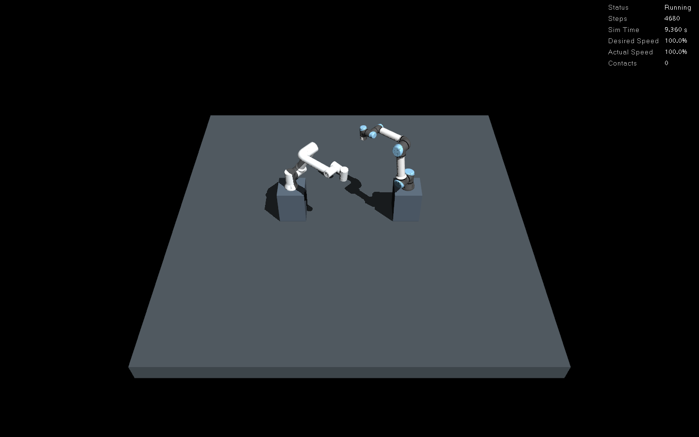
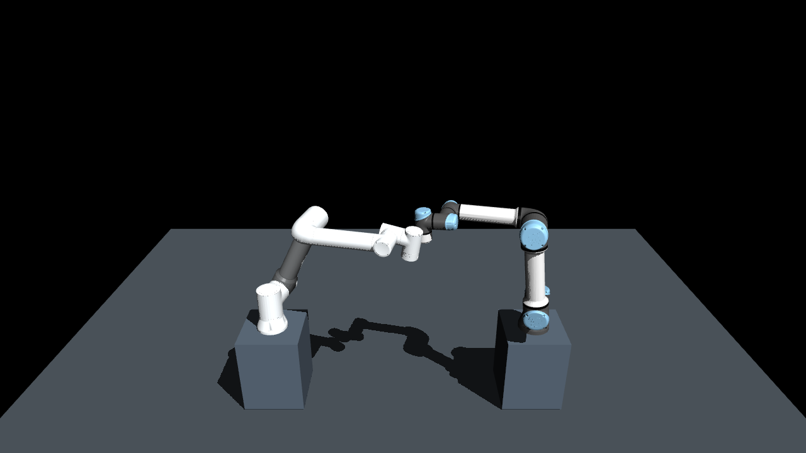

# 양팔 간섭 회피 전용 사례

[README](../README.md) · [공동 장면](workcells.md) · [계획](plans/base_and_multi_robot.md) · [사례 설정](../config/scenarios/dual_arm_crossing.yaml)

## 비교하는 조건

FR5·UR5e의 기존 받침대와 배치를 그대로 사용합니다. 시작·목표 자세는 각각 충돌하지 않습니다.
첫 관절은 양팔 모두 -0.7 → 0.3rad, 나머지는 사례 YAML에 지정한 자세를 사용합니다.
시작 자세로 가는 준비 동작부터 공동 계획·검사 후 실행합니다.

같은 전체 시작 상태에서 팔별 MoveIt 계획을 구하고, 상대 팔을 시작 자세에 고정한 전체 상태로
각 계획을 검사하면 모두 안전합니다. 두 계획을 동일 시간축에 합치면 중간에
`left_wrist2_link`와 `right_wrist_2_link`/`right_wrist_3_link` 간섭이 발생합니다.
짧은 계획만 느리게 늘리고 속도·가속도를 함께 조정하며, 빠르게 압축하지 않습니다.

위험한 병렬 계획은 전송 게이트에서 거부합니다. 이 참조 궤적은 실제 로봇 지령으로 보내지 않습니다.
이어서 **같은 전체 시작 상태와 목표 제약**으로 `both_arms` 12관절 공동 계획을 요청합니다.
공동 궤적을 검사한 후 같은 시각의 팔별 궤적으로 분배해 실행하고, 두 Action 성공과 실제 자세 수렴을 확인합니다.
시작·목표 제약의 허용 오차는 0.003rad, 실행 후 상태 오차 기준은 0.01rad입니다.

## 구현과 판정

- 사례와 자세는 `config/scenarios`에 두며 로봇 모델·작업장면 설정을 복제하지 않습니다.
- 실제 제어기의 `interpolation_method=splines`를 조회합니다. 위치만 있으면 선형,
  속도까지 있으면 3차, 가속도까지 있으면 5차 보간으로 중간 자세를 계산합니다.
  단순 위치 직선 보간으로 속도·가속도에 의한 오버슈트를 놓치지 않도록 검사합니다.
  [Humble 제어기 보간 설명](https://control.ros.org/humble/doc/ros2_controllers/joint_trajectory_controller/doc/trajectory.html)
- 모든 궤적 점과 20ms 이하 시간 간격을 검사하고 관측 관절 간격 0.025rad 초과는 거부합니다.
  미지/중복 관절, 겹친 소유권, 누락된 전체 관절, 비정상 시간·수치·도함수 배열도 거부합니다.
- 독립 계획 두 개의 검사 성공, 합성 시 실제 교차 접촉 링크 검출, 전송 수 증가 없음이 음성 대조 조건입니다.
- 공동 계획은 충돌 상태 0, 양팔 Action SUCCEEDED(4), 양팔 각각 0.8rad 초과 이동,
  실제 목표 수렴과 정지 래치 없음이 필요합니다. 첫 이동 시각이 완전히 같아야 한다고 요구하지는 않습니다.
  하나의 공동 궤적 안에서 움직임을 늦추거나 자세를 바꾸는 것이 회피의 일부이기 때문입니다.
- 실행 후 네이티브 보고서의 현재 실행 ID·감시 코드 해시·전체 스텝 수 일치·접촉 0·정지 래치 없음도 검사합니다.
- 실행별 `trajectories.json`에 준비·팔별·공동 계획을 단계마다 저장합니다.
  중간 실패도 JSON/로그와 마지막 계획·간섭 좌표를 보존합니다.

## 재현 명령

빌드된 ROS Humble 환경에서 저장소 루트 기준입니다.

```bash
source ./manipulation_env.sh
python3 verify_interference.py --domain 126
python3 verify_interference.py --domain 127
python3 verify_interference.py --gui --domain 128 \
  --record-dir runtime/validation/interference_capture_new
```

촬영 폴더는 새 `runtime/` 하위 경로여야 합니다. 촬영은 현재 PC의 X11 도구·OpenCV H.264 지원을 사용하며 CI에는 포함하지 않습니다.
설치된 패키지는 `manipulation-verify-interference`로도 실행합니다.
일반 장면의 계획 설정은 유지하고, 이 검증만 `planning_case:=dual_arm_crossing`을 전달합니다.

공동 장면 CI는 위 headless 검증을 새 launch에서 두 번 실행하며 재시도로 실패를 숨기지 않습니다.
기존 단일 로봇·공동 동작·접촉·시계·크래시·A/B 검사는 유지합니다.

## 계획 후처리 설정을 보강한 이유

기본 설정 재실행에서 시간 파라미터화 후 경로 검사 중 손목 충돌이 발견돼 MoveIt이 계획을 거부했습니다.
[실패 보고서](interference_avoidance/default_settings_failure.json)와 [로그](interference_avoidance/default_settings_failure.txt.gz)를 보존했습니다.
이때 위험한 공동 경로는 전송되지 않았습니다.

MoveIt 공식 문서는 TOTG가 원래 경로에서 허용 편차 내의 새 점을 만들 수 있어 추가 충돌 검사가 필요하다고 설명합니다.
[Humble 문서](https://moveit.picknik.ai/humble/doc/examples/time_parameterization/time_parameterization_tutorial.html),
[Humble 어댑터 소스](https://github.com/moveit/moveit2/blob/humble/moveit_ros/planning/planning_request_adapter_plugins/src/add_time_optimal_parameterization.cpp)

기하 경로 원본과 후처리 경로를 모두 저장한 실행은 아니므로 단일 원인으로 단정하지 않습니다.
이 사례에는 경로 편차 `path_tolerance=0.001`, 후처리 간격 `resample_dt=0.02`,
OMPL 검사 비율 `longest_valid_segment_fraction=0.001`을 적용했고 실제 ROS 파라미터를 대조합니다.
후처리 결과와 실제 제어기 보간도 다시 검사합니다. 무작위 OMPL 계획의 형상·시간은 실행마다 달라질 수 있고,
검사를 통과한 계획만 전송합니다. 이 설정이 모든 목표에서 성공을 보장하지는 않습니다.

## 검증 결과와 영상

2026-10-20 로컬 ROS Humble 결과입니다. 준비 동작을 포함한 물리 스텝을 검사했습니다.

| 실행 | 독립 계획 합성 간섭 샘플 | 공동 경로 충돌 샘플 | 공동 궤적 길이 | 최대 추종 오차 | 물리 스텝 / 접촉 | 원본 |
|---|---:|---:|---:|---:|---|---|
| headless_1 | 51 | 0 | 15.57초 | 0.00404rad | 12,476 / 0 | [JSON](interference_avoidance/headless_1.json) |
| headless_2 | 50 | 0 | 12.02초 | 0.00404rad | 10,626 / 0 | [JSON](interference_avoidance/headless_2.json) |
| gui | 51 | 0 | 21.90초 | 0.00404rad | 17,202 / 0 | [JSON](interference_avoidance/gui.json) |

단위 80개·모델 18개, 총 98개 검사 통과. headless 두 번과 실제 NVIDIA GUI 실행 모두
위험 지령 0회, 양팔 성공, 접촉 0, 정상 종료와 프로세스 잔류 없음을 확인했습니다.

아래는 **실제로 실행한 공동 회피 동작**입니다. 24fps·약 24.08초, 원본 MuJoCo 창 픽셀이며
속도 변경·장면 합성을 하지 않았습니다. 영상과 전후 프레임을 직접 확인했습니다.
원본 로그와 계획은 무손실 gzip으로 보관합니다. 계획의 압축 해제 SHA-256은 GUI 보고서의 `trajectories_sha256`과 일치하고,
로그별 원본 해시는 [보관 명세](interference_avoidance/published_manifest.json)의 `compressed_logs_original_sha256`에 있습니다.
[촬영 정보](interference_avoidance/recording.json) · [계획 원본](interference_avoidance/trajectories.json.gz)

[](interference_avoidance/coordinated-avoidance.mp4)

[영상 재생](interference_avoidance/coordinated-avoidance.mp4) · [완료 화면](interference_avoidance/after.png)

아래는 영상과 달리 **전송되지 않은 참조 궤적의 충돌 좌표를 모델로 렌더링한 분석 이미지**입니다.
실제 실행의 충돌 장면으로 해석하지 않습니다. [출처·좌표](interference_avoidance/reference-collision.json)



새 실행의 같은 좌표를 렌더링하려면 다음을 사용합니다.

```bash
.venv/bin/python scripts/render_interference_witness.py \
  --report runtime/validation/interference_dual_arm_crossing_fr5_ur5e_gui.json \
  --output-dir runtime/validation/interference_capture_new
```

분석 렌더는 Python MuJoCo 3.14.0의 정적 `mj_forward` 결과이며, 실제 ROS 실행의 네이티브 MuJoCo는 3.12.0입니다.

## 남은 범위

이산 샘플 검사는 연속 시간 전체의 무충돌 보장이 아닙니다. 실제 실행은 별도로 모든 물리 스텝을 검사하지만
제조사 STL의 충돌 근사·접촉 모델과 실제 하드웨어를 동일하게 보장하지 않습니다.
끝단 Pose/IK 사례, 실제 도구·그리퍼·하중, 크래시 후 위치 유지와 전체 성능 비교는 남아 있습니다.
전용 간섭 사례를 검증했어도 M5 전체 완료로 표시하지 않습니다.
