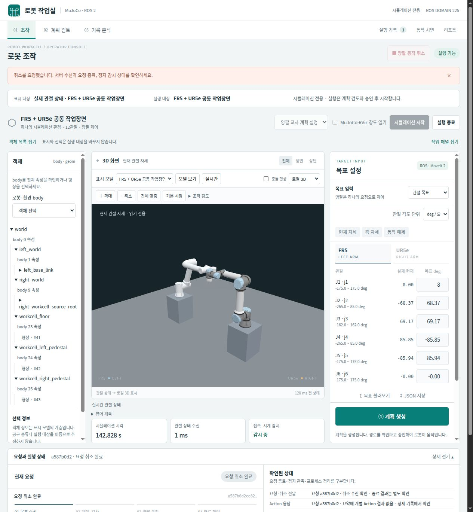

# 전용 통합 조작 화면

[프로젝트 README](../README.md) · [시뮬레이터 제작 상태](simulator_status.md) · [기존 명령 규약](motion_requests.md)

현재 **FR5·UR5e 공동 작업 환경**을 로컬 브라우저 한 화면에서 조작할 수 있습니다.
시뮬레이터 시작·종료, 실시간 모델 뷰, 양팔 12관절 목표, 계획 검토와 승인·실행·취소, 진행 단계·결과·오류,
요청 이력과 보관 리포트를 연결했습니다. 브라우저에서는 자유 카메라를 제공하는 로컬 3D 화면을 기본으로 사용합니다.
준비된 FR3·FR5·FR10·UR5e를 읽기 전용으로 선택할 수 있으며, 제어는 현재 FR5·UR5e 공동 작업 환경의 관절 목표를 사용합니다.
목표 종류에서 관절 목표 또는 등록한 끝단 원점의 TCP Pose 목표를 선택합니다.
물리 그리퍼·물체 집기와 실물 제어는 이 일반 ROS 조작 경로에 아직 연결하지 않았습니다.

## 작업실 구성

상단의 **조작 · 계획 검토 · 기록 분석**은 화면의 목적을 바꿉니다. 메뉴를 바꾸거나 패널을
접어도 목표 입력을 유지하며, 계획 생성·승인·취소를 자동으로 요청하지 않습니다.

- **조작:** 왼쪽에는 표시 모델의 실제 body·geom 목록, 가운데에는 3D 화면, 오른쪽에는 목표를 배치합니다.
  body를 펼쳐 속성을 읽거나 형상을 선택해 3D 화면에서 강조하고 맞출 수 있습니다.
  목록과 캔버스 선택은 서로 연결되며, 모델이 바뀌면 이전 선택은 제거됩니다.
- **계획 검토:** 같은 3D 화면을 유지하고 오른쪽 패널을 계획 수치·미리보기·승인으로 전환합니다.
  계획 생성 요청을 보내면 이 화면으로 이동합니다. 목표를 수정하려면 조작 화면으로 돌아갑니다.
  검토 중에는 형상을 숨기거나 투명하게 바꿀 수 없습니다.
- **기록 분석:** 보존한 RGB 수신 순번과 요청 이벤트를 읽습니다. 선택한 이미지 시점과 3D 자세는
  동기 재생하지 않으며, 공급원 상태는 현재 수신 상태임을 표시합니다.

하단 **요청과 실행 상태**에서 요청·취소 전달, Action 응답, 현재 정지 감시, 요청 종료,
현재 소유 프로세스를 따로 확인합니다. 요청 취소 완료를 물리 정지나 자원 정리 성공으로
해석하지 않습니다. 요약에 없는 근거는 미확인으로 남기고 **현재 요청 기록 보기**로 원본에 접근합니다.

객체 목록과 작업 패널, 하단 상세는 접을 수 있습니다. 1024px에서는 객체 목록을 기본으로 접고,
휴대폰에서는 3D 화면 아래에 작업 패널을 배치합니다. **양팔 동작 취소**는 화면 상단에 유지합니다.
독립 MuJoCo 집기는 기존 별도 실행 경로를 유지합니다.

## 계획을 검토하고 실행하기

상단의 **표시 대상**과 **실행 대상**을 먼저 확인합니다. 다른 로봇 모델을 미리 보더라도
실행 대상은 현재 연결한 FR5·UR5e 공동 작업 환경입니다. 계획 자세를 표시하는 동안에도
관절표의 **실제 현재** 값과 감시 상태는 실시간 수신 상태를 나타냅니다.

1. 목표를 입력하고 **계획 생성**을 누릅니다. 이 단계에서는 로봇을 움직이지 않습니다.
2. 계획 방식, 예정 궤적 시간, 양팔 사이 최소 간격과 최대 관절 변화를 확인합니다.
   궤적 시간은 시뮬레이션 초이며, 변화량은 계획 시작 자세에서 목표까지의 관절 차이입니다.
3. **경로 미리보기**를 열고 재생하거나 시간 막대를 이동합니다. 0.25·0.5·1배 재생과
   **최소 간격 시점** 이동을 사용할 수 있습니다. 해당 시점이 없는 이전 기록에서는 이동 버튼을 제공하지 않습니다.
4. 로컬 3D 화면에 경로가 표시된 뒤 **검토한 계획 승인·실행**을 누릅니다.
   서버는 시작 자세와 모델·환경을 다시 검사하고, 저장한 동일 궤적을 한 번만 실행합니다.

계획은 발급 후 60초 동안 유효합니다. 만료되거나 목표를 바꿨다면 **실시간 복귀·새 계획**으로
현재 입력을 다시 계획합니다. 이 버튼은 실행을 승인하지 않으며 새 경로에도 검토와 승인이 필요합니다.
**실행 기록**에서는 계획과 승인 실행 요청을 한 작업으로 묶어 보여줍니다. 작업 상세의 요약·진행·결과와
접힌 원본 자료에서 각 요청 ID를 확인할 수 있습니다.

상태·자세 조회는 본문 수신까지 3초로 제한합니다. 상태 조회가 끊기면 마지막 표시와 연결 중단을 알리고
새 실행을 차단합니다. 조회는 다시 시도하지만 실행·승인 명령을 자동 재전송하지 않습니다.
그래픽 표시를 잃으면 **3D 다시 시작**으로 3D 화면과 자세를 확인하거나 **서버 이미지로 전환**할 수 있습니다.
서버 이미지 선택은 미리보기를 종료하고 실시간 보기로 돌아옵니다. 표시 복구는 로봇 명령을 보내지 않습니다.



2026-10-28 실제 ROS·MuJoCo 연결 화면입니다. [이전 조작 화면](operator/images/console-desktop.png)은 변경 이력으로 보존합니다.

## TCP Pose 목표와 완료 확인

**TCP Pose 목표**에서 팔과 등록한 기준점을 선택하고 world 위치(m), 방향 quaternion
xyzw를 입력합니다. 현재 `left_flange_reference`와 `right_flange_reference`는 URDF 끝단
링크 원점의 0-offset 참조입니다. 공구 길이나 그리퍼 형상을 추가하는 설정이 아닙니다.
현재 TCP를 읽어 입력하는 버튼은 아직 없으며, 목표 위치와 방향을 직접 입력합니다.

**IK 확인·계획 생성**은 별도 `/workcell/motion/pose_plan` 토픽으로 계획만 요청합니다.
기존 관절 목표 v1 명령은 변경하지 않습니다. 서버는 전체 관절 상태를 seed로 사용하고,
선택한 팔의 충돌 없는 IK 해를 FK로 다시 확인합니다. 다른 팔은 검토할 spline 전체에서
목표 위치를 유지하며, 양팔의 실행 소유권은 여전히 하나입니다. 실제 다른 팔의 추종 오차가
0이라는 뜻은 아닙니다.

Pose 계획의 관절 목표 허용치는 0.0003 rad이며, 계획 종점의 TCP 오차는 위치 1 mm·방향
0.003 rad 이내여야 합니다. 승인 시 IK를 다시 계산하지 않고 검토한 동일 궤적을 실행합니다.
Action 성공과 관절 정착 뒤에도 실제 관절 상태의 FK를 확인하며, 위치 5 mm·방향 0.03 rad를
넘으면 요청을 실패로 기록합니다. 후속 작업을 자동으로 진행하지 않습니다.
**실행 기록 → 작업 상세**에서 계획 TCP 오차와 관측 TCP 오차, 완료 기준을 따로 확인합니다.

원문 Pose, TCP 정의·SHA와 검토 경로는 같은 digest에 묶습니다. 입력 변경·만료·환경 변경,
지원하지 않는 TCP나 IK 실패는 실행 승인이 되지 않습니다. 현재 Cartesian 목표를 이미
만족하는 경우에는 별도 TCP 확인 후 이동 불필요로 끝내며 승인 토큰을 발급하지 않습니다.

2026-10-28 로컬 대표 검증은 독립 ROS 도메인의 IK·계획·승인 실행과 잘못된 TCP SHA,
도달 불가 목표, 환경 변경, 대기 중 취소의 전송 0회를 확인했습니다. 첫 실행은 관절 성공에도
TCP 위치 오차 6.509 mm로 실패했으며 보존했습니다. 완료 판정 보강 뒤 대표 실행에서는
3.890 mm, 실제 브라우저·HTTP 경로에서는 4.212 mm를 관측했습니다. 전체 작업 공간이나
실물 로봇의 정확도 성능을 나타내는 수치는 아닙니다.

## 충돌 정지와 경로 비교를 직접 실행하기

화면의 **동작 시연** 메뉴에서 다음 두 비교를 실행할 수 있습니다. 일반 조작으로 시작한 실행이 있다면
먼저 **실행 종료**를 누릅니다. 각 비교는 같은 도메인에서 새 시뮬레이션을 차례로 실행하므로,
다른 곳에서 시작한 시뮬레이션이 남아 있으면 시연을 시작하지 않습니다.

1. **장애물 접촉 정지 비교**는 고정 기둥에 닿았을 때 양팔이 멈추는 조건과, 기둥 없이 같은 왕복 명령을 완료하는 조건을 비교합니다.
2. **공동 경로와 출발 시점 비교**는 현재 모델에서 새 경로를 계획하고, 같은 시작 자세와 목표를 사용하는 공동 계획 경로와 출발 시점 조정을 비교합니다.
3. **시연 실행**을 누르면 현재 조건의 3D 화면과 진행 단계를 볼 수 있습니다. 조건별 결과에는 접촉, 정지, 간격, 관절 이동량과 궤적 시간을 표시합니다.
4. **시연 중단**은 현재 시연 전체를 종료합니다. 정리를 마친 뒤에만 취소 완료로 표시하며, 다음 조건과 최종 비교를 실행하지 않습니다.

접촉 시연은 기존 [고정 장애물 시험](contact_comparison.md)의 정지 감시를 확인하기 위해
시뮬레이션 전용 시험 궤적을 직접 전송합니다. 일반 관절 조작의 경로 계획과는 별도의 고정 시험이며,
시연 중에는 일반 목표 전송과 명령 노드 연결을 허용하지 않습니다. 이 정지 동작을 실물 안전 기능으로 검증한 것은 아닙니다.

경로 시연은 [기존 출발 시점 비교](timing_coordination.md)의 검증 코드를 재사용합니다.
과거 영상을 재생하거나 저장된 경로의 모델 해시를 바꾸지 않고, 현재 모델에서 성공한 새 준비 실행으로
경로 묶음과 출발 지연 계획을 만듭니다. 준비와 계산에 걸리는 시간은 실제 궤적 시간과 다릅니다.
먼저 끝난 조건도 두 조건에 같은 관찰 시간을 적용하므로, 완료 후 관찰 중인 단계를 따로 표시합니다.
이 비교는 고정 사례의 결과이며 임의 작업의 최단 경로를 보장하지 않습니다.

장애물이 있는 실행에서는 실제 `contact_test.xml`의 형상을 표시합니다. 실행 ID·모델·관절 상태가 맞는
3D 화면만 표시하며, 다음 조건을 준비할 때는 이전 자세를 숨깁니다. 시연의 진행은 브라우저 렌더 완료에 의존하지 않습니다.
선택 가능한 서버 이미지 방식은 기존 JPEG·job·run·모델 SHA 대조를 사용하고, 렌더 검증 도구는 첫 프레임도 검사합니다.
전체 원본 보고서는 로컬 `runtime/validation/runs/`에, 시연 상태와 비교 결과는
`runtime/operator/<세션>/demos/<job ID>/`에 남습니다. 최근 시연 목록은 현재 화면 서버 세션에서 유지됩니다.

```bash
source ./manipulation_env.sh
# 별도의 빈 도메인에서 HTTP → 실제 ROS 시연과 중단 검사
python3 verify_operator_demos.py --domain 156 --port 8879 --no-render
# 각 실행의 실제 EGL 프레임도 확인
python3 verify_operator_demos.py --domain 156 --port 8879
```

## 뷰어 개발 방향성

[구성·채택 배경·대안 비교·개선 계획 HTML](operator/viewer-direction-2026-10-22/index.html)에
통합 조작 화면의 구현 구조와 기술 선택을 개발 사례로 소개합니다.
현재 이미지 표시와 웹 클라이언트 3D·Qt·RViz·Foxglove의 차이, 기존 기능 검증과 후속 확장·평가 계획을 구분합니다.

## 2026-10-22 현재 상태와 동작 비교

[공개 뷰어 상태·비교 영상 HTML](https://wannasleep3254.github.io/mujoco-ros2-manipulation/operator/picking-comparison-2026-10-22/index.html) · [저장소 HTML](operator/picking-comparison-2026-10-22/index.html) ·
[뷰어 조작 확대 MP4](operator/picking-comparison-2026-10-22/viewer-interface-focus.mp4) ·
[전체 UI 원본 MP4](operator/picking-comparison-2026-10-22/viewer-interface.mp4) ·
[뷰어·MuJoCo·RViz 비교 MP4](operator/picking-comparison-2026-10-22/viewer-mujoco-rviz.mp4) ·
[모션 확대 비교 MP4](operator/picking-comparison-2026-10-22/motion-closeup.mp4)

HTML은 목표 입력·불러오기·계획 후 실행·진행 및 완료 표시가 보이는 **뷰어 조작 확대**를 기본으로 표시합니다.
상단 제목·로고와 하단 안내·로그·푸터를 잘라 조작부를 확대했으며 시뮬레이션 시작·종료, 목표 입력·실행·취소 버튼과 진행·완료 표시는 유지합니다. 전체 UI 원본은 별도 링크로 보존합니다.
세 화면 비교와 모션 확대 비교는 영상 선택 버튼으로 전환하며 같은 재생 시점을 유지합니다.
이 페이지는 녹화 자료이며 실제 조작은 [로컬 조작 화면](http://127.0.0.1:8765/)에서 수행합니다.

흐림을 줄이기 위해 같은 구도를 DPR 2의 2400×2360px PNG로 재촬영했습니다. 첫 영상은 축소된 비교 영상에서 추출하지 않고 PNG 원본에서 2400×1796px로 직접 잘라 H.264 CRF 14로 인코딩했습니다.
이번 촬영용 3D 렌더러는 1920×1280px·JPEG 품질 97을 사용했습니다. 기본 제품 렌더러의 960×640px 설정과 최대 5fps는 변경하지 않았습니다.
전체 UI 영상·비교 영상·측정 표·구간 이동 시간도 같은 새 실행으로 갱신했습니다.

공동 작업 환경 실행·12관절 목표·단위 전환·JSON 입출력·계획 후 실행·취소·상태·기록은 구현·검증했습니다.
3D 화면 클릭으로 목표 지정, TCP 드래그, Pose/IK 입력, 단일 모델 선택, 그리퍼·물체 파지는 후속 범위입니다.
이번 접근·후퇴는 오프라인 역기구학으로 준비한 관절 목표를 기존 화면에서 불러와 실행했습니다.
뷰어의 Pose/IK 기능을 구현한 것으로 해석하지 않습니다.

약 44.2초 촬영에서 FR5 상부 위치 이동 → 약 25cm 접근 → 후퇴 → 홈 복귀 4개 요청이 모두 성공했습니다.
관측 종료점 사이의 하강량은 249.6mm이며, 기준 프레임은 `left_wrist3_link`입니다.
물체·그리퍼·작업 TCP는 없고 실제 파지는 수행하지 않았습니다. 관절 공간 계획이므로 직선 접근을 보장하지 않습니다.
UR5e에는 홈 목표를 유지하도록 명령했으며 추종·계획 목표 허용 오차에 따른 작은 변화가 포함됩니다.

영상은 같은 ROS 도메인 151의 실제 Chromium 페이지 캡처, 네이티브 MuJoCo X11 창,
같은 URDF·실제 TF만 표시하는 RViz RobotModel 창을 함께 기록했습니다.
MoveIt 계획·목표 자세 표시가 실제 로봇과 겹치는 혼동을 줄이기 위해 RViz의 계획용 잔상은 제외했습니다.
뷰어 표시 상한은 5fps, 영상은 시간 보존을 위한 반복 프레임을 포함한 12fps입니다.
카메라 각도와 표시 지연은 서로 다르며 프레임별 지연 성능이나 완전한 시각 동기화를 검증한 결과는 아닙니다.

단일 시연의 성공은 임의 목표의 회피 성능을 보장하지 않습니다.
30mm 조건으로 거부되는 홈 복귀 사례 재현·거리 조건을 반영한 재계획이 현재 내부 기능의 우선 과제입니다.
PR #20·#21 병합과 main CI 여섯 개 통과는 확인했고, 이번 문서·영상은 이후 별도 작업 브랜치에서 작성했습니다.

## 실행

[설치·런타임 빌드](setup.md)를 마친 뒤, 실행 중인 시뮬레이션을 종료하고 저장소 루트에서 공동 작업 환경을 준비합니다.
기본 단일 모델 빌드만으로는 이 화면에 필요한 공동 작업 환경이 생성되지 않습니다.

```bash
python3 build_workspace.py --component models --workcell fr5_ur5e
source ./manipulation_env.sh
python3 operator_console.py --domain 89 --port 8765
# 설치형 CLI: manipulation-operator --domain 89 --port 8765
```

출력된 [로컬 조작 화면](http://127.0.0.1:8765/)을 엽니다.
처음에는 로봇을 움직이지 않고 연결 상태를 확인합니다.

1. 빈 도메인에서는 **시뮬레이션 시작**을 누르고 **실행 가능**을 기다립니다. MuJoCo·MoveIt·감시 노드와 상시 명령 노드를 함께 준비합니다.
2. **현재 자세 / 홈 자세 / 동작 예제**로 입력을 채우거나, 팔 탭에서 목표 관절값을 수정합니다. 이 버튼들은 입력만 바꾸며 이동 명령을 보내지 않습니다.
3. **양팔 공동 계획** 또는 **팔별 경로 + 출발 타이밍 조정**을 선택하고 **① 계획 생성**을 누릅니다. 계획·거리·MoveIt 검사를 수행하며 아직 궤적을 전송하지 않습니다.
4. **경로 미리보기**에서 계획을 재생하고 확인합니다. 이 단계는 로봇을 움직이지 않습니다.
5. **③ 검토한 계획 승인·실행**을 누르면 서버가 같은 경로와 현재 상태를 다시 검사한 뒤 실행합니다. 만료되거나 시작 자세·모델·환경이 달라졌으면 새 계획이 필요합니다. **계획 폐기**로 미승인 계획을 버릴 수 있습니다.
6. 진행 단계·Action 결과·상태 수렴을 확인합니다. **양팔 동작 취소**는 상단에 고정되어 있으며, 계획 중·동작 중인 현재 요청에 취소를 전달합니다.
7. **실행 종료**는 이 화면이 시작한 명령 노드·시뮬레이터만 정상 종료합니다.

상단 **MuJoCo·RViz 창도 열기**를 선택하면 기존 네이티브 창도 함께 실행합니다.
계획 설정은 기본 설정과 기존 양팔 교차 사례의 계획 해상도 설정을 선택하며, 로봇 배치를 바꾸는 옵션은 아닙니다.

### 이미 실행 중인 시뮬레이션 연결

같은 ROS 도메인의 시뮬레이션·명령 노드가 실행 중이면 상태를 관측하고 기존 명령 인터페이스를 사용합니다.
시뮬레이션만 있고 명령 노드가 없으면 **실행 중인 시뮬레이션에 명령 노드 연결**이 나타납니다.
현재 생성 모델과 같은 MuJoCo 하드웨어·시뮬레이션 시간·관절 구성을 확인한 뒤 연결합니다.
중복 상태·시계·명령 노드가 있으면 새 명령을 막습니다. 수동 토픽 모니터는 명령 소유자로 취급하지 않습니다.

외부에서 시작한 시뮬레이션은 이 화면의 종료 기능으로 죽이지 않습니다.
화면 서버를 Ctrl+C로 종료하면 자신이 시작한 프로세스를 정리하고,
외부 명령 노드에 자신이 제출한 진행 요청이 있으면 취소를 전달합니다. 외부에서 제출한 진행 요청은 임의 취소하지 않습니다.
브라우저 탭을 닫는 것은 화면 서버 종료나 모션 취소가 아닙니다.

## 입력·상태·결과

- 화면 입력은 deg/rad를 선택할 수 있으며, 전송·저장 형식은 기존 **관절명 → rad 값** JSON입니다. 팔 탭을 바꿔도 양팔 입력이 유지됩니다.
- **목표 불러오기**는 모든 관절·한계·유한 수와 중복 JSON 키를 검사합니다. 불러오기 자체는 이동하지 않습니다. **JSON 저장**은 현재 양팔 목표를 내려받습니다.
- 전송 시 요청 ID를 생성하고 즉시 화면에서 다음 전송을 막습니다. 동일 ID 재전송은 실행을 반복하지 않으며, 다른 목표로 ID를 재사용하면 거부합니다.
- 상태가 오래됐거나 시계가 정지/역행한 경우, 접촉·시계 잠금, 명령 노드 미준비·중복 연결이면 실행 버튼을 비활성화하고 이유를 표시합니다.
- **실행 기록**에는 최근 40개 관측 요청의 성공·실패·취소·거부를 표시합니다. 상세에는 원본 이벤트·구간·계획 시간·거리·양팔 결과를 표시합니다.
- 연결이 끊겨도 명령을 자동 재전송하지 않습니다. 명령 노드가 바뀌어 종료를 확인할 수 없는 요청은 **결과 미확인**으로 남깁니다.
- 화면의 취소는 기존 협력식 취소입니다. 진행 중 RPC/네이티브 계산은 반환 후 반영될 수 있고, 취소 요청 표시와 실제 취소 완료를 구분합니다. 하드웨어 비상정지 기능은 아닙니다.

새 HTML 리포트는 기존 발행 절차로 생성합니다. 화면의 **평가 리포트**는 저장소 `catalog.json`의 보관 자료를 열며,
현재 실행을 새 성능평가로 자동 발행하지 않습니다.

## 로컬 3D와 읽기 전용 보기

네이티브 MuJoCo 3.12.0이 물리를 적분하고 ROS 제어기가 명령을 수행합니다.
별도 CPU worker는 같은 생성 MJCF를 MuJoCo 3.14.0으로 읽고 관절 상태에 `mj_forward`만 적용합니다.
브라우저는 고정된 메시와 좌표를 받아 그립니다. worker와 브라우저는 물리를 적분하거나 로봇 명령을 발행하지 않습니다.

- **실시간**은 현재 공동 작업 환경의 관절 상태를 표시합니다. 드래그 회전, 휠 확대, 오른쪽 드래그 이동과 전체·정면·상단 보기를 제공합니다. 카메라는 상태 수신과 독립적으로 움직입니다. **확대·축소·기본 시점** 버튼도 사용할 수 있습니다. **조작 감도**에서 회전·줌·이동을 각각 0.25~3배로 조절하며 조작·시연 화면에 함께 적용합니다. 같은 페이지의 모델·작업 환경 전환에서는 유지하고 새로고침하면 1배로 돌아갑니다.
- **모델 보기**는 준비된 단일 로봇이나 현재 작업 환경을 실행 연결 없이 확인합니다. 이 모드에서는 시작·명령 노드 연결·목표 전송·시연 시작을 서버에서도 거부합니다. 실시간으로 돌아온 뒤에는 기존 상태·시계·감시 조건을 다시 통과해야 제어할 수 있습니다.
- **실행 기록 → 저장 궤적 보기**는 이 화면에서 성공한 실행의 검증된 궤적을 별도 모델에서 다시 표시합니다. 재생과 시간축 이동은 명령을 보내지 않습니다. 현재 승인 대기 계획의 **경로 미리보기**와 구분합니다.
- **충돌 형상**은 같은 컴파일 모델의 충돌 메시를 추가로 표시합니다. 새로운 충돌 판정이나 실물 안전 인증을 수행하는 버튼은 아닙니다.

모델·자산 SHA와 콘솔 세대, 시연 job/run, 명령 세션, 선택한 요청을 묶어 이전 응답을 구분합니다.
표시할 작업 환경이 바뀌면 이전 모델을 숨기고 새 모델과 자세가 모두 맞을 때 표시합니다. 상태가 0.5초보다 오래되면 마지막 자세를 흐리게 표시하며 카메라는 유지합니다.
시연이 끝나면 마지막 자세와 종료 상태를 구분하고, 모델 변경·시각 역행·재연결 때는 새 상태 확인을 요구합니다.

**전체 맞춤**은 현재 보이는 형상을 모두 포함하면서 바라보는 방향을 유지합니다. **기본 시점**은 로봇 중심의 기본 방향으로 돌아갑니다.
3D 화면에서 형상을 클릭하거나 **형상 선택** 목록에서 고르면 강조 표시와 **선택 맞춤**을 사용할 수 있습니다.
이름이 없는 형상은 번호와 종류로 표시합니다. 로봇 전체나 부품 계층을 자동으로 분류하는 기능은 아닙니다.

선택한 형상의 **숨김**과 **불투명도**는 브라우저 표시만 바꿉니다. 불투명도는 원본 재질에 곱해 적용하고,
충돌 형상 표시와 개별 숨김을 함께 반영합니다. 다른 작업 환경으로 바꾸면 선택과 개별 표시 설정을 초기화합니다.
실행 전 **계획 검토 중에는 개별 숨김과 불투명도 변경을 막고 기존 설정도 초기화**합니다. 선택과 화면 맞춤은 계속 사용할 수 있습니다.

3D 화면은 새 자세, 카메라 조작, 크기나 표시 설정이 바뀔 때 다시 그립니다. 감쇠가 끝난 정지 화면에서는 반복 제출을 쉬므로
표시 FPS가 0이어도 연결 중단을 뜻하지 않습니다. 실시간 자세 조회는 화면이 보일 때 기존 250 ms 간격을 유지합니다.
모델 보기와 멈춘 기록은 필요한 자세만 받고, 숨긴 화면은 자세 조회를 줄입니다. 실행 상태 확인과 취소 처리는 그대로 유지합니다.

**뷰어 계측**에는 표시·자세 적용 FPS, 최근 CPU 제출 시간의 p95, 실제 GL renderer와 draw call·삼각형·자원 수를 표시합니다.
최근 자원 이력은 크기를 제한해 보관합니다. geometry·texture·program 개수는 GPU 메모리 바이트 수가 아닙니다.
원본 상태의 경과 시간과 브라우저의 요청 소요를 함께 고려하며, 서버와 브라우저의 서로 다른 monotonic 시각을 빼지 않습니다.
`render_submit_ms`와 그 p95는 CPU의 렌더 명령 제출 시간으로 GPU 완료 시간이나 전체 입력 지연을 뜻하지 않습니다.
표시 지표와 MoveIt 계획·거리 검사 시간은 별도로 해석합니다.

2026-10-26 [JPEG·WebGL 표시 성능 예비 평가](reports/2026-10-26-viewer-display/index.html)에서는 방식별 15초 구간 3개를 비교했습니다. WebGL은 평균 59.95 FPS로 그리면서 새 자세를 4.00회/초 적용했고, 반복 HTTP 응답 본문은 122.99→67.50 kB/s로 45.1% 줄었습니다. 평가 서버 프로세스 CPU 합계는 58.64%→59.28%(코어 하나=100%)로 비슷했습니다. JPEG 960×640과 WebGL 621×414의 정지 자세·기본 설정 비교이며 초기 자산·브라우저 자원·입력→paint·이동·원격 환경은 제외합니다. [뷰어 개선 기록](operator/viewer-improvements-2026-10-26/index.html)에 표시 구조와 조작 보완, 남은 검증을 정리했습니다.

WebGL 2를 사용할 수 없으면 **서버 이미지**를 선택할 수 있습니다. 이 방식은 기존 MuJoCo EGL/Pillow 렌더러의
최대 5fps JPEG를 사용하며 자유 카메라는 전체·정면·상단 프리셋으로 제한됩니다. 이미지 방식에서는 로컬 3D 좌표 worker를 쉬게 합니다.
미리보기는 로컬 3D에서 사용하며, 표시 방식의 변경은 진행 중인 요청이나 시연이 끝난 뒤에 합니다.

로컬 Three.js 0.186.1과 OrbitControls는 공식 npm 배포본의 무결성과 파일 SHA를 고정해 포함합니다.
CDN에 접속하지 않으며 MIT 라이선스와 원본 배포 정보는 `static/vendor/`에 보존합니다.
현재 기본 작업 환경의 두 자세에서 3.12 물리 라이브러리와 3.14 표시 모델의 좌표를 대조했습니다.
이 확인은 임의 모델·컴파일러 버전·충돌 판정의 동등성을 보장하지 않습니다. 표시 모델의 엔진 버전과 자산 SHA는 manifest에 남깁니다.

## 구성과 기록

| 경로 | 역할 |
|---|---|
| `src/mujoco_ros2_manipulation/operator_console/` | ROS 어댑터·상태·소유 프로세스 관리·로컬 HTTP API |
| 같은 폴더의 `static/` | 외부 CDN·프레임워크 없는 HTML/CSS/JS |
| `operator_console.py` | 기존 환경을 사용하는 호환 실행 진입점 |
| `runtime/operator/<세션>/events.jsonl` | 시작·전송·취소·종료와 소유 PID·로그 |
| `runtime/operator/<세션>/launch-*/` | 원본 ROS 로그·요청 JSON·매 물리 스텝 진단 `physics.json` |
| `runtime/operator/<세션>/demos/<job ID>/` | 시연 상태·고정 입력·비교 결과와 worker 로그 |
| `runtime/operator/<세션>/scene-view/` | 소유한 CPU worker의 현재 표시 환경·좌표 캐시 |
| `runtime/operator/<세션>/frame.*` | 이미지 방식을 선택했을 때의 최신 JPEG·메타데이터 |

서버는 `127.0.0.1`에만 바인딩합니다. 변경 요청은 같은 출처와 세션 토큰을 확인하며,
정해진 실행 옵션·JSON 계약·보고서 파일만 사용합니다. 브라우저에서 임의 셸 명령·파일 경로·실물 IP를 실행하는 API는 없습니다.
웹 프레임워크를 추가하지 않고 Python/ROS·MuJoCo를 사용합니다. 로컬 3D 자산은 패키지에 포함하며, 이미지 방식은 기존 Pillow·EGL 설치를 사용합니다.

## 검증

```bash
PYTHONPATH=src runtime/report-tools/bin/python -m unittest tests.unit.test_operator_console -v
source ./manipulation_env.sh
python3 verify_operator_console.py --domain 143 --no-render --startup-cycles 2 --startup-hold-seconds 2
# EGL 렌더러도 실제 구동하는 로컬 검사
python3 verify_operator_console.py --domain 143 --port 8878
# 실제 MuJoCo·RViz·웹 렌더러 동시 실행, 3회 시작/종료 후 기존 이동·취소 검사
python3 verify_operator_console.py --domain 146 --port 8881 --native-gui --startup-cycles 3 --startup-hold-seconds 15
```

새 로컬 3D의 CPU 경로·모델 선택·명령 차단·저장 계획 재생은 별도 검사로 확인합니다.

```bash
python3 verify_operator_views.py --domain 231 --port 8890
```

기존 렌더 검증 도구에서 `--no-render`를 생략하면 **서버 이미지**를 명시적으로 선택해 JPEG 대조 경로를 검사합니다.
브라우저의 실제 WebGL·카메라 동작은 이 CPU 검사와 별도로 확인합니다.

실제 HTTP 검증은 새 시뮬레이터를 준비해 잘못된 목표 거부, 양팔 물리 이동·성공,
중복 ID의 재실행 방지, 동작 중 동시 요청 거부·양팔 취소, 출발 조정 복구, 정상 종료와 접촉 0을 검사합니다.
실패·정리 오류를 포함한 결과와 원본 세션 사본은 `runtime/validation/runs/<ID>/`에 보존합니다.
CI는 디스플레이·GPU 없이 `--no-render`로 같은 실제 ROS 경로를 검사합니다.
브라우저 버튼·레이아웃·렌더링 검증은 실제 로컬 브라우저에서 별도로 수행합니다.


## 2026-10-21 실제 검증 결과

평가 구현은 `9e6a0c67a9f8c9992cfc56b6e2288d5b71853bc1`입니다.
실제 HTTP·ROS·EGL 검증 `20261021T104643.608766Z-21a701d4`는 양팔 성공·이동 중 양팔 취소·복구,
매 물리 스텝 접촉 0과 모든 소유 프로세스 정상 종료를 통과했습니다.
단위 테스트 169개(조작 화면 경계 검사 13개), sdist/wheel 빌드와 저장소 밖 설치형 CLI·화면 자산 검사를 통과했습니다.

실제 브라우저에서는 관절 단위·팔별 입력 유지·JSON 입출력·중복 키 거부, 카메라 전환,
공동 계획 성공 → 실제 이동 중 양팔 취소 → 출발 조정 복구 → 충돌 목표 실패(이동 없음),
기록 상세·리포트·모바일 가로 넘침 없음·상단 취소 버튼·종료/재시작 후 실제 동작 성공을 확인했습니다.
브라우저의 5개 요청과 별도 HTTP 회귀 3개 요청은 기능 검증용이며 성능 표본을 합쳐 평균내지 않습니다.
화면 서버·브라우저 검사에서 다른 프로세스가 제출한 명령이나 시뮬레이션을 종료하지 않았습니다.

[검증 원본 (gzip JSON)](operator/validation.json.gz) · [파일·화면 해시](operator/validation-manifest.json) ·
[양팔 취소 화면](operator/images/console-cancelled.png) · [실행 기록](operator/images/console-history.png) · [모바일 화면](operator/images/console-mobile.png)

## 2026-10-22 네이티브 GUI 동시 실행 오류 수정

사용자 실행 `launch-005`, `launch-007`에서 제어기 시작 노드가
`Failed to find a free participant index for domain 144`로 실패했습니다.
이어 명령 노드가 `Timeout: contact guard ready` 또는 `Timeout: shared state and clock`으로 종료됐고,
화면의 소유 프로세스 관리가 MuJoCo·RViz까지 SIGINT로 정리했습니다.
두 실행의 네이티브 진단에는 접촉·무효 수·시계 불연속이 없고 약 1.0배속으로 물리가 진행됐습니다.
확인한 원인은 DDS 참가자 슬롯 부족이며, 관측된 창 종료는 준비 실패에 따른 정상 정리였습니다.

[공통 환경](setup.md#공통-코드-구성)에 DDS 참가자 32개 설정을 추가했습니다.
사용자 DDS 설정은 보존합니다. 핵심 프로세스 종료 시 화면에는 종료 코드·로그 경로와
확인된 DDS 슬롯 부족 원인을 표시합니다. 준비 시간 제한과 접촉·시계 감시는 유지합니다.
기존 버전으로 실행 중인 화면 서버에는 코드와 환경이 자동 반영되지 않습니다.
필요한 기록을 보존하고 화면의 **실행 종료**, 서버의 Ctrl+C 후 다음과 같이 재시작합니다.

```bash
source ./manipulation_env.sh
python3 operator_console.py --domain 144 --port 8765
```

별도 도메인 146의 검증 `20261022T021707.225994Z-bf3e6f0a`에서
실제 네이티브 MuJoCo·RViz와 웹 렌더러를 함께 3회 시작하고 각 준비 후 15초를 유지했습니다.
양팔 정상 실행·동작 중 양팔 취소·홈 복귀·모든 소유 프로세스 정상 종료를 통과했고 접촉은 0이었습니다.
단위 검사 175개(조작 화면 15개, ROS 없는 환경 정책 4개 포함)를 통과했습니다.
이는 해당 실행 조건의 회귀 검증이며 장시간 내구성 시험 결과는 아닙니다.
원래 사용자 도메인 144의 세션은 종료하지 않았습니다.

[실제 GUI·ROS 검증 원본](operator/gui-startup-validation.json.gz) ·
[실행 조건·구현 해시](operator/gui-startup-validation-manifest.json)

추가로 도메인 97·98에서 실제 ROS 노드 12개를 시작한 슬롯 비교에서는 기존 설정이 9개 준비·3개 슬롯 부족,
수정 설정이 12개 모두 준비였고 검사 프로세스는 모두 회수했습니다. 기존 설정에서 실제 사용할 수 있는 수는
다른 참가자의 점유 상황 등에 따라 기본 상한보다 작을 수 있습니다.
CI와 같은 헤드리스 조건에서도 2회 시작·종료와 실제 이동·취소·복귀를 통과했습니다.
위 원본에는 실행 결과와 재현용 슬롯 비교 스크립트를 함께 보존했습니다.

## 2026-10-23 실시간 비교 시연 검증

헤드리스 HTTP·ROS 검증 `20261023T074630.127717Z-27eb79f1`과 EGL 검증
`20261023T074915.944866Z-ba5aade4`에서 접촉/대조군, 새 공동 계획/출발 시점 조정,
첫 조건 중 중단과 후속 조건 차단, 소유 프로세스 정리를 통과했습니다.
EGL 검사는 성공 비교의 5개 run에서 현재 job·run·모델과 일치하는 최신 프레임을 확인했습니다.
실제 HTTP JPEG의 내용과 프레임 해시 일치도 별도로 확인했습니다.

기존 일반 조작은 `20261023T074947.303499Z-61c826e0`에서 두 번 시작·종료한 뒤
양팔 이동·중복 방지·취소·복구·정상 종료를 통과했습니다. 전체 단위 검사 253개와
저장소 구문·링크, 웹 스크립트 구문, wheel·sdist 빌드를 확인했습니다.
브라우저에서도 경로 비교 실행, 상태·A/B 결과, 실제 시연 중단을 확인했습니다.
새 시연의 네이티브 MuJoCo·RViz 창 동시 실행과 실물 로봇은 검사하지 않았습니다.
원본은 각 ID의 로컬 `runtime/validation/runs/` 아래에 보존하며 공개 문서에는 실행 결과만 요약합니다.


## 설계환경 미리보기

로컬 STEP 자산으로 만든 새 환경을 `--view-scene-catalog`로 시작 시 등록할 수 있습니다.
등록한 환경은 모델 미리보기로만 표시하며, 기본 제어 환경과 실행 대상은 그대로입니다.
단위·좌표계·설치 위치·충돌 근사와 로컬 파일 취급은 [설계파일 반영 절차](environment_design_import.md)를 참고합니다.
명시적으로 가져온 환경을 실행 대상으로 선택하는 별도 기능은 [설치 환경 실행](environment_execution.md)을 참고합니다. 표시 모델 선택만으로 실행 대상이 바뀌지 않습니다.


## 공통 공급원과 실행 전 검토

일반 목표는 계획 생성 후 경로를 미리 보고 승인하여 실행합니다. 기존 성공 이력의 궤적 재생과 별도 흐름입니다. [표시 데이터 규약·ROS 없는 기록 연결·계획 승인](viewer_sources.md)에 계약과 실행 절차를 정리했습니다. [움직이는 기록의 성능·안정성 평가](viewer_display_benchmark.md)는 기존 정지 자세 예비 측정을 보존한 별도 결과입니다.
