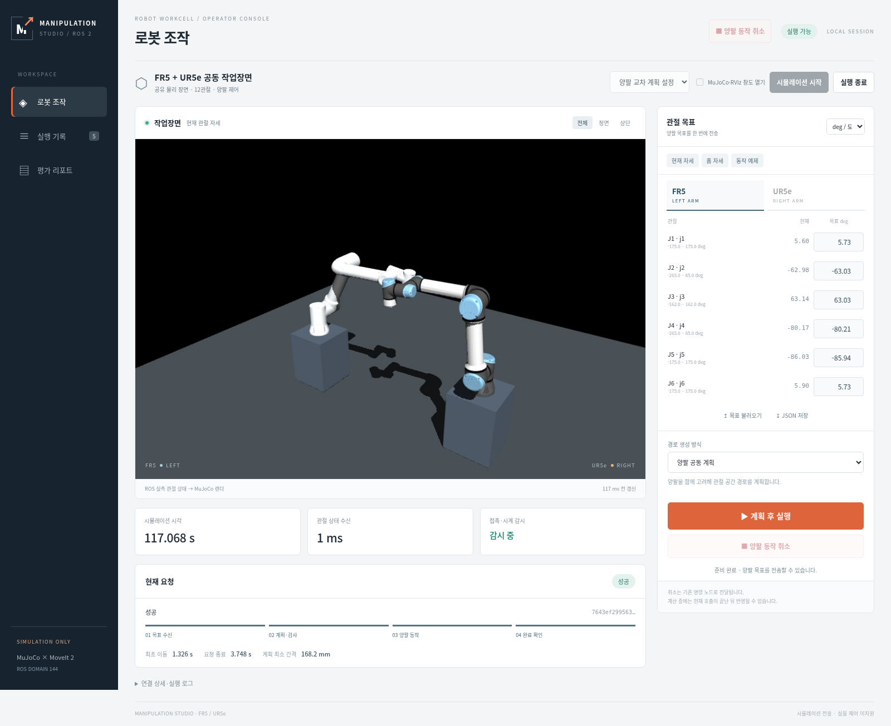

# 전용 통합 조작 화면

[프로젝트 README](../README.md) · [시뮬레이터 제작 상태](simulator_status.md) · [기존 명령 규약](motion_requests.md)

현재 **FR5·UR5e 공동 작업장면**을 로컬 브라우저 한 화면에서 조작할 수 있습니다.
시뮬레이터 시작·종료, 실시간 모델 뷰, 양팔 12관절 목표, 계획 후 실행·취소, 진행 단계·결과·오류,
요청 이력과 보관 리포트를 연결했습니다. 단일 FR5·FR10·UR5e의 기존 CLI/RViz 실행은 유지합니다.
이번 화면에서 단일 모델 선택, Pose/IK 목표, 그리퍼·TCP, 실물 제어는 지원하지 않습니다.



## 실행

저장소 루트에서 기존 ROS 환경을 적용합니다. 모델·런타임 빌드는 [설치 안내](setup.md)를 따릅니다.

```bash
source ./manipulation_env.sh
python3 operator_console.py --domain 89 --port 8765
# 설치형 CLI: manipulation-operator --domain 89 --port 8765
```

출력된 [로컬 조작 화면](http://127.0.0.1:8765/)을 엽니다.
처음에는 로봇을 움직이지 않고 연결 상태를 확인합니다.

1. 빈 도메인에서는 **시뮬레이션 시작**을 누르고 **실행 가능**을 기다립니다. MuJoCo·MoveIt·감시 노드와 상시 명령 노드를 함께 준비합니다.
2. **현재 자세 / 홈 자세 / 동작 예제**로 입력을 채우거나, 팔 탭에서 목표 관절값을 수정합니다. 이 버튼들은 입력만 바꾸며 이동 명령을 보내지 않습니다.
3. **양팔 공동 계획** 또는 **팔별 경로 + 출발 타이밍 조정**을 선택하고 **계획 후 실행**을 누릅니다. 기존 계획·안전검사 후 양팔에 명령을 보냅니다.
4. 진행 단계·Action 결과·상태 수렴을 확인합니다. **양팔 동작 취소**는 상단에 고정되어 있으며, 계획 중·동작 중인 현재 요청에 취소를 전달합니다.
5. **실행 종료**는 이 화면이 시작한 명령 노드·시뮬레이터만 정상 종료합니다.

상단 **MuJoCo·RViz 창도 열기**를 선택하면 기존 네이티브 창도 함께 실행합니다.
계획 설정은 기본 설정과 기존 양팔 교차 사례의 계획 해상도 설정을 선택하며, 로봇 배치를 바꾸는 옵션은 아닙니다.

### 이미 실행 중인 장면 연결

같은 ROS 도메인의 장면·명령 노드가 실행 중이면 상태를 관측하고 기존 명령 인터페이스를 사용합니다.
장면만 있고 명령 노드가 없으면 **기존 장면에 명령 노드 연결**이 나타납니다.
현재 생성 모델과 같은 MuJoCo 하드웨어·시뮬레이션 시간·관절 구성을 확인한 뒤 연결합니다.
중복 상태·시계·명령 노드가 있으면 새 명령을 막습니다. 수동 토픽 모니터는 명령 소유자로 취급하지 않습니다.

외부에서 시작한 장면은 이 화면의 종료 기능으로 죽이지 않습니다.
화면 서버를 Ctrl+C로 종료하면 자신이 시작한 프로세스를 정리하고,
외부 명령 노드에 자신이 제출한 진행 요청이 있으면 취소를 전달합니다. 외부에서 제출한 진행 요청은 임의 취소하지 않습니다.
브라우저 탭을 닫는 것은 화면 서버 종료나 모션 취소가 아닙니다.

## 입력·상태·결과

- 화면 입력은 deg/rad를 선택할 수 있으며, 전송·저장 형식은 기존 **관절명 → rad 값** JSON입니다. 팔 탭을 바꿔도 양팔 입력이 유지됩니다.
- **목표 불러오기**는 모든 관절·한계·유한 수와 중복 JSON 키를 검사합니다. 불러오기 자체는 이동하지 않습니다. **JSON 저장**은 현재 양팔 목표를 내려받습니다.
- 전송 시 요청 ID를 생성하고 즉시 화면에서 다음 전송을 막습니다. 동일 ID 재전송은 실행을 반복하지 않으며, 다른 목표로 ID를 재사용하면 거부합니다.
- 상태가 오래됐거나 시계가 정지/역행한 경우, 접촉·시계 잠금, 명령 노드 미준비·중복 연결이면 실행 버튼을 비활성화하고 이유를 표시합니다.
- **실행 기록**에는 최근 40개 관측 요청의 성공·실패·취소·거부를 표시합니다. 상세에는 원본 이벤트·구간·계획 시간·거리·양팔 결과를 표시합니다.
- 연결이 끊겨도 명령을 자동 재전송하지 않습니다. 명령 노드가 바뀌어 종료를 확인할 수 없는 요청은 **결과 미확인**으로 남깁니다.
- 화면의 취소는 기존 협력식 취소입니다. 진행 중 RPC/네이티브 계산은 반환 후 반영될 수 있고, 취소 요청 표시와 실제 취소 완료를 구분합니다. 하드웨어 비상정지 기능은 아닙니다.

새 HTML 리포트는 기존 발행 절차로 생성합니다. 화면의 **평가 리포트**는 저장소 `catalog.json`의 보관 자료를 열며,
현재 실행을 새 성능평가로 자동 발행하지 않습니다.

## 라이브 모델 뷰의 의미

네이티브 MuJoCo 3.12.0이 물리를 적분하고, ROS 제어기가 명령을 수행합니다.
별도 `.venv` 렌더러는 같은 생성 MJCF를 MuJoCo 3.14.0으로 읽고 `/joint_states`의 관절 자세를 적용해 최대 5fps로 그립니다.
렌더러는 `mj_step`을 호출하거나 명령·시계를 발행하지 않습니다. 표시된 갱신 시간은 실제 프레임의 경과 시간이며,
5fps는 설정 상한으로 GUI 성능평가 결과가 아닙니다. 원본 상태가 오래되면 마지막 화면에 갱신 대기를 표시합니다.

전체·정면·상단 카메라를 제공합니다. 렌더링 오류는 실행 로그에 표시하며 상태·취소 기능과 분리합니다.
화면에 보이는 두 로봇은 받은 관절 상태를 그린 것으로, 별도 독립 물리 세계의 동작을 합성한 화면이 아닙니다.

## 구성과 기록

| 경로 | 역할 |
|---|---|
| `src/mujoco_ros2_manipulation/operator_console/` | ROS 어댑터·상태·소유 프로세스 관리·로컬 HTTP API |
| 같은 폴더의 `static/` | 외부 CDN·프레임워크 없는 HTML/CSS/JS |
| `operator_console.py` | 기존 환경을 사용하는 호환 실행 진입점 |
| `runtime/operator/<세션>/events.jsonl` | 시작·전송·취소·종료와 소유 PID·로그 |
| `runtime/operator/<세션>/launch-*/` | 원본 ROS 로그·요청 JSON·매 물리 스텝 진단 `physics.json` |
| `runtime/operator/<세션>/frame.*` | 최신 관절 상태 이미지·렌더 메타데이터 |

서버는 `127.0.0.1`에만 바인딩합니다. 변경 요청은 같은 출처와 세션 토큰을 확인하며,
정해진 실행 옵션·JSON 계약·보고서 파일만 사용합니다. 브라우저에서 임의 셸 명령·파일 경로·실물 IP를 실행하는 API는 없습니다.
추가 웹 프레임워크·JavaScript 패키지 없이 기존 Python/ROS·MuJoCo·Pillow 설치를 사용합니다.

## 검증

```bash
PYTHONPATH=src runtime/report-tools/bin/python -m unittest tests.unit.test_operator_console -v
source ./manipulation_env.sh
python3 verify_operator_console.py --domain 143 --no-render
# EGL 렌더러도 실제 구동하는 로컬 검사
python3 verify_operator_console.py --domain 143 --port 8878
```

실제 HTTP 검증은 새 시뮬레이터를 준비해 잘못된 목표 거부, 양팔 물리 이동·성공,
중복 ID의 재실행 방지, 동작 중 동시 요청 거부·양팔 취소, 출발 조정 복구, 정상 종료와 접촉 0을 검사합니다.
실패·정리 오류를 포함한 결과와 원본 세션 사본은 `runtime/validation/runs/<ID>/`에 보존합니다.
CI는 디스플레이·GPU 없이 `--no-render`로 같은 실제 ROS 경로를 검사합니다.
브라우저 버튼·레이아웃·렌더링 검증은 실제 로컬 브라우저에서 별도로 수행합니다.


## 2026-10-21 실제 검증 결과

평가 구현은 `9e6a0c67a9f8c9992cfc56b6e2288d5b71853bc1`입니다.
실제 HTTP·ROS·EGL 검증 `20261021T104643.608766Z-21a701d4`는 양팔 성공·이동 중 양팔 취소·복구,
매 물리 스텝 접촉 0과 모든 소유 프로세스 정상 종료를 통과했습니다.
단위 테스트 169개(조작 화면 경계 검사 13개), sdist/wheel 빌드와 저장소 밖 설치형 CLI·화면 자산 검사를 통과했습니다.

실제 브라우저에서는 관절 단위·팔별 입력 유지·JSON 입출력·중복 키 거부, 카메라 전환,
공동 계획 성공 → 실제 이동 중 양팔 취소 → 출발 조정 복구 → 충돌 목표 실패(이동 없음),
기록 상세·리포트·모바일 가로 넘침 없음·상단 취소 버튼·종료/재시작 후 실제 동작 성공을 확인했습니다.
브라우저의 5개 요청과 별도 HTTP 회귀 3개 요청은 기능 검증용이며 성능 표본을 합쳐 평균내지 않습니다.
화면 서버·브라우저 검사에서 다른 프로세스가 제출한 명령이나 시뮬레이션을 종료하지 않았습니다.

[검증 원본 (gzip JSON)](operator/validation.json.gz) · [파일·화면 해시](operator/validation-manifest.json) ·
[양팔 취소 화면](operator/images/console-cancelled.png) · [실행 기록](operator/images/console-history.png) · [모바일 화면](operator/images/console-mobile.png)
