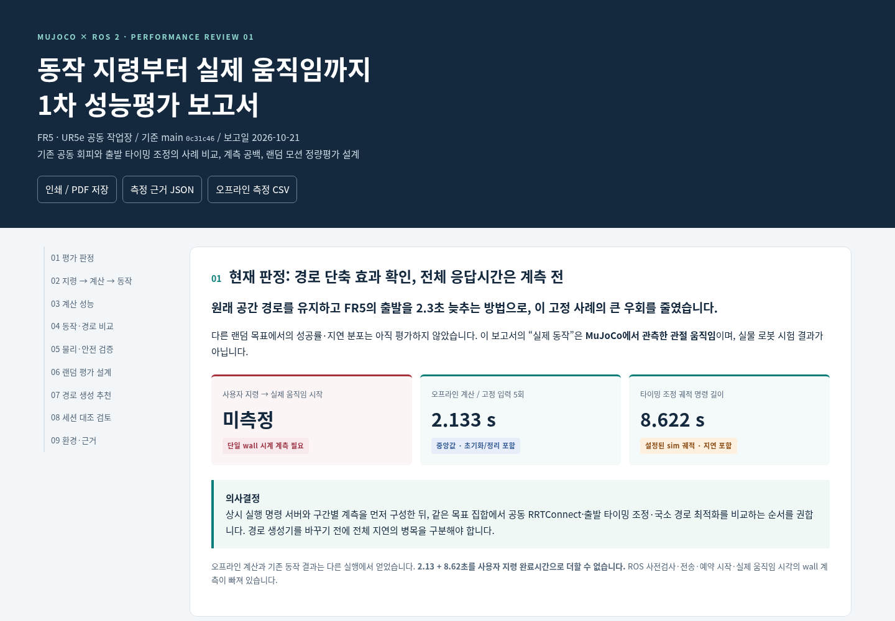

# 1차 성능평가 리포트 — 2026-10-21

[HTML 리포트](phase1-performance.html) · [세션 대조 검토](review.md) ·
[측정 근거 JSON](evidence.json) · [오프라인 5회 CSV](offline-trials.csv) · [파일 해시](manifest.json)

GitHub에서는 HTML이 소스로 표시됩니다. 저장소를 내려받은 뒤 HTML 파일을 브라우저로 열거나,
파일 화면에서 Download raw file로 내려받아 엽니다. 그림·동영상·측정 데이터가 HTML에 포함되어
인터넷 연결 없이 표 전환·JSON/CSV 내려받기·인쇄가 가능합니다. 외부 공식 문서 링크는 별도입니다.

```bash
xdg-open docs/reports/2026-10-21-phase1/phase1-performance.html
```



## 기준과 해석 범위

- 기준 코드: 원본 저장소 main `0c31c469f08f853c775222a098706bef3f154bb7` (PR #13 병합).
- FR5·UR5e의 동일한 양팔 교차 사례 1개. GUI/headless 동작 근거는 2026-10-20 기록을 보존했습니다.
- 2026-10-21 오프라인 재측정은 같은 고정 입력을 5회 반복한 결과입니다.
  총 중앙값 2.133초, 출발 시점 탐색 중앙값 1.891초이며, 새 MoveIt 계획·ROS 검사·지령·실행 시간은 제외합니다.
- 명령된 궤적 시간 26.628→8.622초는 시뮬레이션 시간입니다. 오프라인 계산 시간과 더해 전체 응답시간으로 사용하지 않습니다.
- 실제 동작은 MuJoCo 관절 상태 관측을 뜻합니다. 랜덤 목표 성공률·P95/P99·실물 로봇 성능은 아직 평가하지 않았습니다.
- ‘모션 플래닝 질문 정리’에서 검토한 이전 소스 사본과 최신 원본의 차이를 HTML 08절과 [검토 문서](review.md)에 명시했습니다.
  사본 동기화와 시뮬레이터·플래너 설정 변경은 수행하지 않았습니다.

## 보존 자료

| 파일 | 내용 |
|---|---|
| [HTML](phase1-performance.html) | 지령→계산→동작, GUI/headless 비교, 영상, 후속 평가 설계, 대안과 세션 대조 |
| [JSON](evidence.json) | 원본 보고서 스냅샷, 실행 ID·해시, 5회 시간, 재계산 시계열, 환경·CI·후처리 정의 |
| [CSV](offline-trials.csv) | 5회 오프라인 세부 시간·후보 수·선택 지연 |
| [시계열 그림](comparison-traces.png) | 보존된 GUI 관절 상태에서 다시 계산한 이동량·팔 간 간격 |
| [브라우저 검증](browser-validation.json) | JS 오류·외부 요청 없음, 화면·표 전환·내려받기·인쇄·영상 확인 |
| [모바일 화면](preview-mobile.png) / [세션 검토 화면](preview-review.png) | 390px 화면과 보완 내용의 시각 확인 |
| [해시 목록](manifest.json) | 이 폴더의 공개 파일 SHA-256·크기. 목록 파일 자체는 제외 |

원본 압축 보고서·관측 파일·영상은 [타이밍 검증 자료](../../timing_coordination.md)에 있습니다.
보고서 생성용 일회성 스크립트·브라우저 캐시·런타임·자격 증명은 포함하지 않습니다.
측정 절차는 HTML의 ‘오프라인 시간 측정의 재현 순서’에 기록했습니다.

## 이번 문서 변경의 검증

저장소 구문·설정·로컬 Markdown 링크 검사, 공개 파일 해시와 HTML 내장 데이터 대조,
CSV 5행 일치, HTML 앵커·로컬 자산 및 JavaScript 검사와 Chrome 화면 검증을 수행했습니다.
1440×1000·390×844에서 문서 가로 넘침 없음, GUI/headless 전환, JSON/CSV 내려받기,
인쇄 스타일 및 내장 영상 메타데이터를 확인했습니다.

로봇 실행 코드가 바뀌지 않아 ROS/GUI 동작·단위·모델 검사는 이번 문서 변경에서 다시 실행하지 않았습니다.
HTML의 기존 92개 단위·20개 모델 검사와 main CI는 기준 구현의 과거 검증 근거입니다.
새 PR CI 결과와 혼동하지 않습니다.
