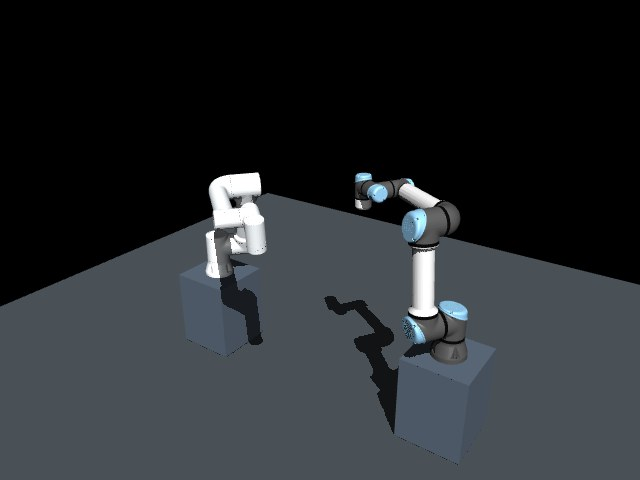
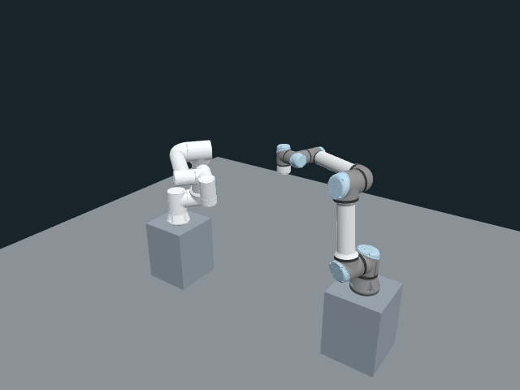

# 움직이는 FR5·UR5e 기록의 표시 검증

같은 640×480 픽셀과 카메라에서 표시 경로를 비교했습니다. 새 프로세스 3회씩 실행했고, WebGL은 별도로 120초 동안 유지했습니다. 이 headless Chrome에서는 SwiftShader가 선택되어 **하드웨어 가속 WebGL의 성능을 평가하지 못했습니다.** 기존 정지 자세 예비 보고서의 수치를 대체하지 않습니다.

이후 사용자 설정을 바꾸지 않고 격리 프로세스 옵션으로 NVIDIA WebGL을 확인하여 [하드웨어 조건을 맞춘 추가 비교](../2026-10-26-viewer-moving-hardware/results.md)를 수행했습니다. 아래 원래 측정 수치는 그대로 보존합니다.

## 조건

- 모델: FAIRINO FR5 + Universal Robots UR5e, XML SHA `acda9ec4cde30de1d2400abb112055ae7a935dfcb134e4020f418352077454d5`.
- 입력: 기존 `dual_arm_crossing` 출발 시점 조정 계획에서 추출한 173개 전체 관절 표본, 8.621950734초. 같은 기록을 반복 재생합니다.
- 코드: 작업 중인 뷰어의 파일별 SHA는 [evidence.json](evidence.json)에 기록했습니다.
- 화면: 640×480, DPR 1, 45° 수직 시야각, 동일한 중앙 카메라 위치·방향·투영 범위, 250 ms 조회.
- 반복: 방식마다 새 HTTP 서버·Chrome 프로세스와 임시 프로필 3개, 초기 준비 후 1초 대기, 각 약 15초 측정. 순서는 WebGL→JPEG / JPEG→WebGL / WebGL→JPEG입니다.
- 브라우저: Chrome 155.0.8059.39 headless. WebGL은 ANGLE SwiftShader 소프트웨어 렌더러입니다.
- JPEG: MuJoCo 3.14.0이 NVIDIA RTX 3050에서 요청마다 렌더링하고 품질 88로 인코딩했습니다. 제품의 비동기 5 Hz 작업자가 아닙니다.
- 호스트: Intel i7-13700, 논리 CPU 24개, Linux 6.8.0-147. 기존 사용자 작업을 유지했습니다.

그림 1. 같은 카메라 조건의 JPEG 표시

그림 2. 같은 카메라 조건의 WebGL 표시

두 그림의 조명·재질·그림자와 캡처된 기록 표본 시각은 다릅니다. 픽셀 색상의 일치나 광학적 정확도를 평가하는 시험은 아닙니다.

## 독립 실행 3회의 중앙값

표 1. 표시·초기 준비·전송량

| 측정값 | JPEG | WebGL |
|---|---:|---:|
| 표시 횟수/초 | 3.990 | 28.236 |
| 새 자세 또는 이미지/초 | 3.990 | 3.981 |
| 장면 초기화→첫 표시 지점 | 26.7 ms | 104.6 ms |
| navigation→ready 확인 | 78.4 ms | 141.0 ms |
| `/frame` 또는 `/pose` 반복 본문 | 68.37 kB/s | 48.65 kB/s |
| 초기 manifest+mesh 본문 | 0 | 3,442,575 bytes |

WebGL의 표시 횟수에는 같은 관절 자세를 다시 그린 프레임이 포함됩니다. JPEG는 decode·canvas draw 후 다음 rAF를 센 값입니다. 실제 화면의 paint 횟수를 측정하지 않았으며, 새 로봇 상태는 두 방식 모두 약 4회/초입니다. 반복 본문량에는 상태 API, 초기 자산, HTTP 헤더와 전송 계층을 포함하지 않습니다.

초기 표시 시간에는 서버 모델 컴파일·EGL 초기화와 Chrome 실행 비용이 포함되지 않습니다. 준비된 서버를 새 페이지에서 여는 시간이며, 전체 시스템의 cold-start 시간으로 해석하지 않습니다.

표 2. 측정 구간의 프로세스 자원 평균을 실행별로 구한 뒤 취한 중앙값

| 측정값 | JPEG | WebGL |
|---|---:|---:|
| 브라우저 CPU, 코어 하나=100% | 1.93% | 1,587.29% |
| 시험 서버 CPU, 코어 하나=100% | 1.93% | 0.60% |
| 브라우저 자손 RSS 합 | 823.33 MiB | 907.24 MiB |
| 시험 서버 자손 RSS 합 | 366.02 MiB | 304.24 MiB |

**이번 환경에서 WebGL이 전체 CPU를 줄였다는 결론은 성립하지 않습니다.** 브라우저가 CPU로 메시를 그리는 반면 JPEG 서버는 NVIDIA GPU를 사용했습니다. 1,587%는 논리 코어 약 15.9개에 해당하는 프로세스 CPU 사용량이며, GPU 사용률이 아닙니다. RSS 합에는 공유 페이지 중복이 있습니다. 전체 시스템·GPU 자원과 계획·제어 성능을 측정하지 않았습니다.

자동화 wheel 입력 18개의 중앙값은 WebGL 이벤트→CPU 제출 0.30 ms, JPEG 이벤트→decode·draw 후 다음 rAF 123.90 ms였습니다. **종료 지점이 달라 이를 카메라 paint 지연의 배율로 비교할 수 없습니다.** 물리 마우스나 화면 출력까지의 지연을 확인한 결과도 아닙니다.

## 안정성

별도 새 WebGL 세션은 120.378초 동안 기록을 표시했습니다. 화면 제출은 28.020 FPS, 새 자세 적용은 3.996회/초였고, 브라우저 오류와 조회 오류는 없었습니다. 이후 10개 확인 항목을 모두 통과했습니다.

1. 소스 중단 시 마지막 자세를 stale로 표시합니다.
2. stale 상태에서도 카메라 줌을 사용할 수 있습니다.
3. stale 상태의 줌 입력이 실제 카메라 위치를 바꿉니다.
4. 새 표본 수신 후 현재 상태로 복구합니다.
5. 잘못된 자세는 일부 기하나 sequence를 덮어쓰지 않습니다.
6. 중복 sequence는 신선도를 갱신하지 않습니다.
7. 새 소스 epoch는 이전 자세를 즉시 숨깁니다.
8. 이전 epoch의 늦은 응답을 거절합니다.
9. 새 epoch에서 sequence 1로 되감은 기록을 표시합니다.
10. 다른 모델 SHA의 응답을 거절하고 마지막으로 수락한 sequence를 유지합니다.

시간 역행은 소유자가 명시적으로 새 epoch를 지정한 경우입니다. 임의의 소스 시간을 뷰어가 직접 판별한다는 뜻이 아닙니다.

## 해석과 후속 확인

로봇 상태를 약 4 Hz로 받아도 카메라와 장면은 별도로 그릴 수 있다는 점, 초기 자산 비용과 반복 전송량이 다르다는 점을 확인했습니다. 동시에 소프트웨어 렌더러를 선택한 환경에서는 브라우저 CPU 부하가 커질 수 있음을 확인했습니다. 이후 [NVIDIA 하드웨어 추가 비교](../2026-10-26-viewer-moving-hardware/results.md)에서도 같은 도구를 실행했으며, 운영 환경의 실제 GL renderer 확인이 필요하다는 점은 같습니다.

수시간 연속 운용, 실제 다른 모델로의 전환, 네트워크 단절, 브라우저 탭 비활성·컨텍스트 손실, 원격 표시, Edge와 Ubuntu 물리 입력 문제는 이 시험의 완료 항목에 포함하지 않습니다. 생산용 비동기 JPEG·ROS 제어 경로와의 비교도 별도 검증입니다.

[측정 도구와 범위](../../viewer_display_benchmark.md) · [원본 JSON](evidence.json) · [고정 입력](recording.json)
