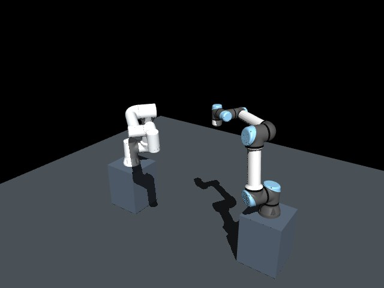
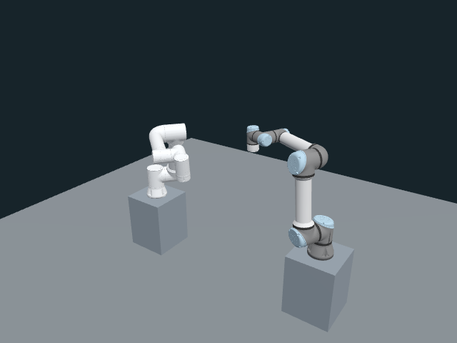

# NVIDIA GPU를 사용한 움직이는 뷰어 비교

JPEG와 WebGL 모두 **같은 NVIDIA RTX 3050** 사용을 확인하고, 같은 640×480 픽셀과 카메라에서 FR5·UR5e 기록을 재생했습니다. 독립 실행 3회의 WebGL 표시 중앙값은 **59.962 FPS**, 새 자세 적용은 **3.989회/초**였습니다. JPEG는 **3.991회/초**였습니다. 화면을 다시 그리는 횟수와 새 로봇 상태가 전달되는 횟수를 구분합니다.

이 결과는 [앞선 SwiftShader 측정](../2026-10-26-viewer-moving-display/results.md)과 분리합니다. 기존 정지 자세 예비 보고서도 수정하지 않았습니다.

## 조건과 실행

- 실제 준비된 FR5·UR5e 모델의 SHA는 `acda9ec4cde30de1d2400abb112055ae7a935dfcb134e4020f418352077454d5`입니다.
- 기존 `dual_arm_crossing` 출발 시점 조정 계획에서 추출한 173개 전체 관절 표본, 8.621950734초 기록을 반복 재생했습니다.
- 640×480, DPR 1, 45° 수직 시야각과 같은 중앙 카메라 위치·방향·투영 범위, 250 ms 조회를 사용했습니다.
- Chrome 155.0.8059.39 headless에 `--use-gl=angle --use-angle=gl --disable-software-rasterizer`를 적용했습니다. WebGL 실제 renderer는 `ANGLE (NVIDIA Corporation, NVIDIA GeForce RTX 3050/PCIe/SSE2, OpenGL 4.5.0)`입니다.
- JPEG는 MuJoCo 3.14.0의 `NVIDIA GeForce RTX 3050/PCIe/SSE2`, NVIDIA 드라이버 580.178.04에서 요청마다 렌더링하고 품질 88로 인코딩했습니다.
- 매번 새 HTTP 서버·Chrome 프로세스와 임시 프로필을 사용했습니다. 초기 준비 후 1초 대기, 방식별 15초×3회이며 WebGL→JPEG / JPEG→WebGL / WebGL→JPEG 순서입니다.
- Intel i7-13700, 논리 CPU 24개, Linux 6.8.0-147에서 기존 사용자 작업을 유지했습니다.

프로세스 옵션만 바꾸었으며 사용자 브라우저와 OS 설정을 수정하지 않았습니다. 사전 확인 한 번의 [GPU 원본](hardware-probe.json)과 각 실행의 실제 renderer를 보존했습니다. 소프트웨어 renderer가 선택되면 하드웨어 시험을 실패 처리합니다.

그림 1. JPEG 표시

그림 2. WebGL 표시

같은 기하와 카메라를 사용하지만 조명·재질·그림자 처리와 캡처한 기록 표본 시각은 다릅니다. 렌더 엔진의 시각적 품질이나 픽셀 색상 일치를 평가하지 않았습니다.

## 독립 실행 3회의 중앙값

표 1. 표시·초기 준비·본문량

| 측정값 | JPEG | WebGL |
|---|---:|---:|
| 표시 횟수/초 | 3.991 | 59.962 |
| 새 자세 또는 이미지/초 | 3.991 | 3.989 |
| 장면 초기화→첫 표시 지점 | 102.1 ms | 641.3 ms |
| navigation→ready 확인 | 155.0 ms | 682.7 ms |
| `/frame` 또는 `/pose` 반복 본문 | 68.39 kB/s | 48.79 kB/s |
| 초기 manifest+mesh 본문 | 0 | 3,442,575 bytes |

WebGL 표시 횟수는 같은 자세의 반복 redraw를 포함합니다. JPEG는 decode·canvas draw 후 다음 rAF에 도달한 횟수이며 실제 paint를 확인하지 않았습니다. 초기 시간은 서버 모델/EGL 초기화와 Chrome 실행이 끝난 뒤 새 페이지에서 측정했습니다. 전체 시스템 cold-start 시간이 아닙니다.

반복 본문량은 상태 API, 초기 자산, HTTP 헤더와 전송 계층을 제외합니다. WebGL 초기 mesh 비용을 별도로 표시했으므로 전체 세션 전송량이 같은 비율로 줄었다고 해석하지 않습니다.

표 2. 구간 평균을 실행별로 구한 뒤 취한 자원 중앙값

| 측정값 | JPEG | WebGL |
|---|---:|---:|
| 브라우저 CPU, 코어 하나=100% | 2.99% | 18.02% |
| 시험 서버 CPU, 코어 하나=100% | 1.73% | 0.60% |
| 브라우저 자손 RSS 합 | 937.25 MiB | 928.72 MiB |
| 시험 서버 자손 RSS 합 | 367.17 MiB | 302.55 MiB |

**이 측정에서도 전체 CPU 감소를 확인한 것은 아닙니다.** WebGL은 서버의 반복 이미지 렌더링을 줄이는 대신 브라우저가 지속적으로 화면을 그립니다. 여기서는 약 60 FPS 표시를 얻으면서 브라우저 CPU를 더 사용했습니다. RSS에는 공유 페이지 중복이 있고, 전체 시스템·GPU 실행 시간·VRAM을 측정하지 않았습니다.

자동화 wheel 입력 18개의 중앙값은 WebGL 이벤트→CPU 제출 **0.30 ms**, JPEG 이벤트→decode·draw 후 다음 rAF **130.55 ms**였습니다. **종료 지점이 다르므로 paint 지연의 배율로 비교할 수 없습니다.** 물리 마우스나 input→display 지연을 확인한 결과도 아닙니다.

## 안정성

별도 새 하드웨어 WebGL 세션을 **120.298초** 유지했습니다. 화면 제출 **60.001 FPS**, 새 자세 적용 **3.998회/초**였으며 브라우저 오류와 조회 오류가 없었습니다. 소스 중단 시 stale 표시, stale 상태의 카메라 조작과 실제 이동, 재연결 복구, 잘못된 자세의 원자적 거절, 중복 sequence 거절, 새 epoch의 이전 자세 숨김, 늦은 이전 epoch 거절, 새 epoch에서의 되감기, 잘못된 모델 SHA 거절을 포함한 **10개 확인을 모두 통과**했습니다.

시간 역행은 시험 소유자가 명시적으로 새 epoch를 지정한 경우입니다. 이 시험이 임의의 공급원 시계를 감지하거나 실제 다른 로봇 모델의 제어 전환을 입증하는 것은 아닙니다.

## 적용 범위

같은 GPU에서 움직이는 기록의 약 60 FPS 표시와 약 4 Hz 상태 수신을 분리할 수 있음을 확인했습니다. 표시 결과를 해석할 때 실제 GL renderer를 함께 확인해야 합니다. 앞선 기본 headless 설정에서는 같은 모델이 SwiftShader로 약 28 FPS와 높은 CPU 사용량을 보였습니다.

이 도구의 JPEG 경로는 요청마다 렌더링하며 생산용 비동기 5 Hz 작업자나 ROS 제어 전체 경로가 아닙니다. 기록을 `mj_forward`로 표시할 뿐 새 계획·실행·충돌 판정을 하지 않습니다. 공급원 교체와 실행 승인 기능의 성능을 새로 측정한 결과도 아닙니다.

수시간 연속 운용, 물리 마우스, Edge, Ubuntu 입력 누락, 탭 비활성·컨텍스트 손실, 실제 모델 전환, 원격 네트워크와 GPU 시간·VRAM은 후속 검증입니다.

[측정 도구와 재현 방법](../../viewer_display_benchmark.md) · [원본 근거](evidence.json) · [고정 기록](recording.json)
