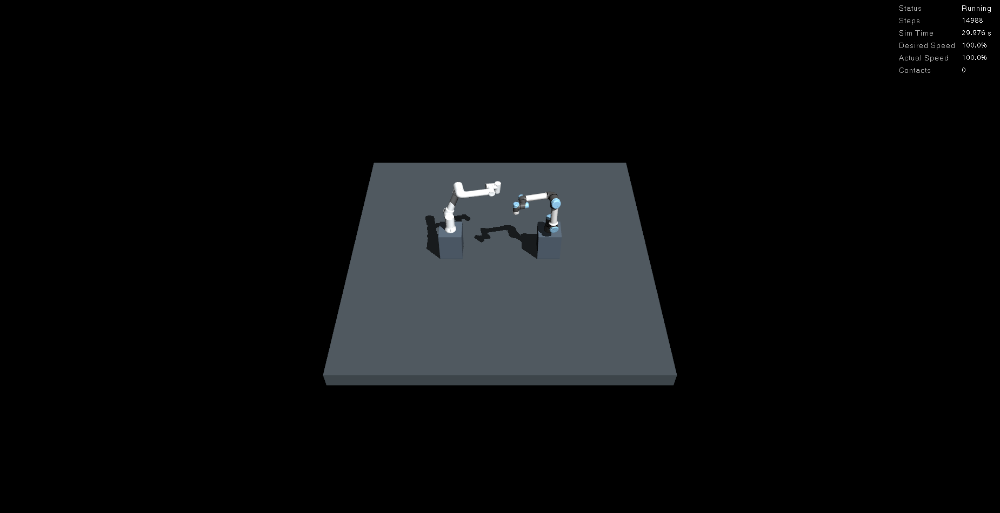
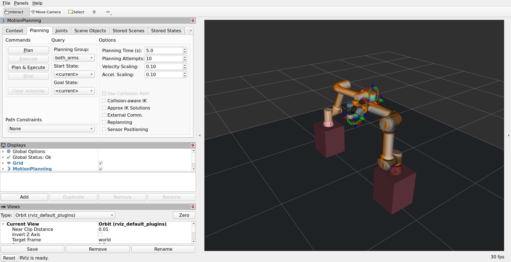

# 시뮬레이터 제작·검증 상태

[프로젝트 README](../README.md) · [실행 안내](workcells.md) · [최신 탐색 비교와 GUI 리포트](reports/2026-10-21-search-optimization/index.html)

확인일: **2026-10-22**. 현재 시뮬레이터는 **MuJoCo 물리 장면 + ROS 2/MoveIt 제어 + RViz + CLI**로 동작합니다.
FR5·FR10·UR5e 단일 모델과 FR5·UR5e 공동 장면을 실행할 수 있습니다.
**FR5·UR5e 공동 장면용 [전용 통합 조작 화면](operator_console.md)을 구현했습니다.**
실시간 모델 뷰·목표 입력·계획 후 실행·양팔 취소·상태/오류·기록·리포트를 한 화면에서 사용합니다.
단일 모델 선택과 Pose/IK·그리퍼/TCP 화면 제어는 후속 범위입니다.
[현재 뷰어 상태·실제 접근/후퇴 비교 영상](operator/picking-comparison-2026-10-22/index.html)에 구현 범위와 제한을 정리했습니다.

## 기능별 판정

| 구성 | 구현·검증 상태 | 근거와 남은 범위 |
|---|---|---|
| 단일 모델 | FR5·FR10·UR5e 생성, ROS 제어, MoveIt, TF, 종료 검증 | [모델별 기록](robots/README.md). 이번 PC 점검은 양팔 공동 장면 대상 |
| 고정 베이스·장면 | 기본 도형·설치 자세·공유 충돌 모델 구현 | [장면 설정](architecture.md). CAD 입력·오목 형상 분할·레일/이동 플랫폼은 후속 |
| 양팔 공동 물리 | 12관절, 두 궤적 제어기, 공유 `/clock`·`/joint_states` | 최신 GUI 실행에서 상태 발행 각 1개·초기 접촉 없음 확인 |
| 계획·명령 | 공동 관절 계획, 팔별 계획과 출발 조정, 상시 목표 입력·취소·완료 피드백 | [명령 규약](motion_requests.md). 이번 실제 ROS 회귀 검사 통과 |
| 간섭·정지 감시 | 경로 거리 검사, 네이티브 매 스텝 접촉 감시, 양팔 정지, 시계 감시 | [접촉 대조](contact_comparison.md)·[시계 실패 주입](clock_stop.md). 이번 GUI에서 충돌 목표 거부·동작 중 양팔 취소 확인 |
| 랜덤 정량평가 | 동일 목표·계산 예산·시작 오차 관리, 실패 보존, HTML/JSON/CSV | [첫 랜덤 평가](reports/2026-10-21-random-motion/index.html). 근거리 목표 5개이며 전체 작업 공간 평가가 아님 |
| 탐색 최적화 | 중복 0초 평가와 최선 지연 이후의 불필요한 후보 제거 | [동일 입력 A/B](reports/2026-10-21-search-optimization/index.html). 6입력 × 두 방식 × 5회에서 선택 경로·지연·거리 평가 정확히 일치 |
| GUI·GPU | 실제 MuJoCo·RViz 화면과 두 소유 프로세스의 NVIDIA GPU 사용 확인 | 아래 원본 캡처·새 리포트. GPU 확인 범위는 렌더링; 현재 물리·계획 계산은 CPU |
| 전용 조작 화면 | FR5·UR5e 공동 장면의 로컬 웹 화면 구현 | [사용·검증 안내](operator_console.md). 단일 모델·Pose/IK·그리퍼 제어는 후속 |
| 작업 기능 | 일부 후속 | 양팔 Pose/IK 전용 사례, 그리퍼·공구 TCP, 집기·조립, 실물 연결은 미검증 |

## 현재 PC와 실제 GUI 확인

CPU는 **Intel Core i7-13700**, GPU는 **NVIDIA RTX 3050 6GB**, 드라이버는 **580.178.04**입니다.
Ubuntu 22.04.5·ROS 2 Humble·MoveIt 2.5.10과 네이티브 MuJoCo 3.12.0을 사용했습니다.
데스크톱은 NVIDIA OpenGL 4.6 하드웨어 렌더링입니다. 이전 GTX 1050 Ti 실행 자료는 과거 기록으로 유지합니다.





검증 실행 `20261021T093837.684967Z-e087f7f3`에서 팔별·공동 계획/실행, 충돌 목표 거부,
양팔 동작 취소, 접촉 0과 정상 종료를 확인했습니다. 창은 자동 검증이 끝난 뒤 함께 닫혔습니다.
스크린샷은 검증기가 소유한 실제 X11 창에서 촬영했고 해시를 보존했습니다.

동작 검사 후 **5wall초 정지 유지 구간**의 real-time factor는 약 **1.000**입니다.
이는 설정 속도로 유지되는지 확인한 값이며, 이동 중 성능·최대 물리 처리량·GUI FPS를 나타내지 않습니다.
GUI 검증과 오프라인 A/B는 별도로 실행했습니다. 원본·범위·실행 환경은 [새 리포트](reports/2026-10-21-search-optimization/index.html)에 있습니다.

## 지금 직접 실행하는 방법

[통합 화면](operator_console.md)을 사용하면 아래 터미널을 나누는 대신 화면에서 실행·입력·취소할 수 있습니다.
기존 탐색 A/B 리포트는 전용 화면 추가 이전의 네이티브 GUI 검증 기록으로 보존합니다.

저장소 루트에서 터미널 1:

```bash
bash run_scene.sh workcell:=fr5_ur5e gui:=true rviz:=true planning_case:=dual_arm_crossing
```

터미널 2에서 명령 노드 실행 후 `READY`를 기다립니다.

```bash
source ./manipulation_env.sh
python3 motion_server.py
```

터미널 3에서 완전한 12관절 목표 JSON을 전송하거나 홈 목표를 보냅니다.
관절명·예제 파일 생성·동작 중 취소는 [상시 명령 안내](motion_requests.md#실행)를 따릅니다.

```bash
source ./manipulation_env.sh
python3 motion_command.py --target /절대경로/target.json --strategy departure_timing
python3 motion_command.py --home
```

같은 ROS 도메인에서 시뮬레이션·명령 노드를 연결하며 한 제어 대상에 명령 노드는 하나만 사용합니다.
자동 평가기는 자신의 시뮬레이션과 명령 노드를 준비하므로 위 대화형 실행과 다른 도메인에서 실행합니다.

```bash
source ./manipulation_env.sh
python3 benchmark_motion.py --seed 20261021 --count 5 --radius 0.25 --compute-budget 5 --domain 139
```

## 다음 개발 순서

1. **내부 계획·제어 안정화:** 30mm 간격 조건으로 거부되는 홈 복귀를 고정 회귀 입력으로 만들고, 거리 조건을 반영한 공간 경로 재계획과 우회 길이·완료시간 평가를 보강합니다.
2. **평가 입력 확장:** 교차·장애물·큰 이동과 다양한 시작/목표를 같은 계산 예산에서 비교하고 실패·미실행도 보존합니다. 이번 4요청 접근·후퇴 시연은 대규모 정량평가가 아닙니다.
3. **뷰어 확장:** 내부 동작이 안정된 뒤 단일 모델·추가 장면, 3D 목표 지정·Pose/IK·계획 미리보기·평가 실행 연결을 추가합니다. 목표 전달·실패 표시·취소 정확성은 내부 기능과 함께 유지합니다.
4. **작업 기능:** 공구 TCP·그리퍼·물체 파지 사례를 추가한 뒤 집기·이송·조립으로 확장합니다.

현재 출발 조정은 원래 관절 경로를 유지하며 설정된 지연 격자에서 선택합니다.
최단 공간 우회, 연속 최적화, 실시간 전역 재계획 또는 대규모 성공률 검증을 완료한 상태는 아닙니다.
