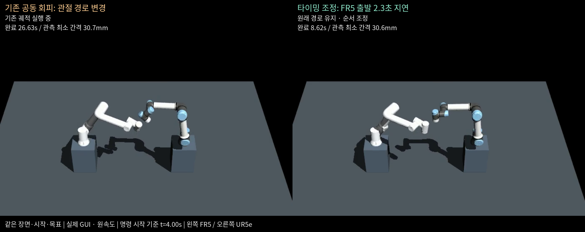

# 거리·경로 평가와 양팔 출발 타이밍 조정

[README](../README.md) · [이전 정상·접촉·회피 비교](interference_comparison.md) · [검증 안내](verification.md)

큰 우회가 생기는 기존 양팔 공동 계획과, 독립 관절 경로를 그대로 두고 출발 시점만 바꾸는 방법을 비교합니다.
동일한 FR5·UR5e 장면·시작·목표 및 한 번 고정한 원본 궤적 묶음을 사용합니다.
기존 자료는 보존하고 이번 비교를 별도로 촬영했습니다. 모델 배치·충돌 형상·서보 게인·접촉 자동 정지는 변경하지 않았습니다.

## 실제 실행 비교

[](timing_coordination/comparison.mp4)

[비교 영상](timing_coordination/comparison.mp4) · [타이밍 조정 완료 화면](timing_coordination/timing-complete.png) ·
[기존 회피 완료 화면](timing_coordination/baseline-complete.png)

왼쪽 칸은 기존 RRTConnect 양팔 공동 경로, 오른쪽 칸은 FR5 출발을 2.3초 늦춘 실행입니다.
각 칸 안에서 흰색이 FR5, 파란 관절 캡이 UR5e입니다. 실제 독립 GUI 실행을 같은 명령 시작 시점에 맞춰
원속도로 재생하고 고정 확대·한글 자막만 추가했습니다. 로봇 픽셀을 생성하거나 움직임을 합성하지 않습니다.
오른쪽 실행이 먼저 완료된 뒤에도 왼쪽 경로의 종료 이후까지 두 영상을 계속 관찰했습니다.

## 이번 사례의 결과

2026-10-20 로컬 GUI 결과입니다. 아래 길이는 **계획된 spline**을 최대 10ms 간격과 모든 knot에서 평가한 값입니다.

| 지표 | 기존 공동 회피 | 출발 타이밍 조정 |
|---|---:|---:|
| 관절별 누적 회전량 합 | 24.6917rad | 2.0237rad |
| FR5 끝단 프레임 경로 | 1.7640m | 0.6953m |
| UR5e 끝단 프레임 경로 | 2.2135m | 0.5515m |
| 궤적 명령 길이 | 26.628초 | 8.622초 |
| 계획 최소 팔 간 간격 | 30.85mm | 33.14mm |
| 실제 관절 상태에서 관측한 최소 간격 | 30.75mm | 30.64mm |
| ROS Action / 물리 접촉 | 양팔 성공 / 0 | 양팔 성공 / 0 |

관절 누적 이동량은 약 **91.8%**, 궤적 시간은 약 **67.6%** 감소했습니다. 같은 사례의 결과이며 모든 작업에서 같은 감소율을 보장하지 않습니다.
무회피 참조의 관절 누적 이동량도 2.0237rad이며, 새 방법은 해당 공간 경로를 유지합니다.
참조를 동시에 실행한 가상 궤적의 최소 간격은 -36.9mm로 간섭합니다. 이번 비교에서는 이 위험 궤적을 실행하지 않았습니다.

끝단은 `left_wrist3_link`, `right_tool0` **프레임 원점**입니다. 실제 공구 TCP 오프셋·그리퍼·하중을 추가한 결과가 아닙니다.
관절 지표는 모든 관절을 같은 가중치로 합한 값이며 미터 단위 이동거리가 아닙니다. 팔별 관절 공간 L2 경로 길이도 JSON에 기록합니다.

## 거리 평가

- `native/path_distance.cpp`와 `workcells/distance.py`가 ROS 시뮬레이터와 같은 잠금 MuJoCo **3.12.0**을 사용합니다.
  Python MuJoCo 3.14.0으로 거리를 대신 계산하지 않습니다. 네이티브 빌드가 라이브러리를 생성하고 소스·바이너리 해시와 엔진 버전을 검사합니다.
- 각 로봇 `base_link` 하위의 충돌 활성 geom 쌍을 모두 대상으로 `mj_geomDistance`의 부호 있는 최소거리를 계산합니다.
  시각화 전용 geom은 제외하며 최근접 링크·점·관절 상태·시점을 보존합니다.
- 이번 거리 정책의 범위는 **두 로봇팔 사이**입니다. 바닥·받침대 등과의 충돌은 기존 MoveIt 검사와 네이티브 전체 물리 스텝 접촉 감시를 유지합니다.
- 계획은 최대 10ms·관절 변화 0.025rad 이하 샘플과 실제 JTC spline 보간을 검사합니다.
  실행 후에는 `/joint_states`의 실제 수신 자세로 거리·경로 길이를 별도 계산합니다. 수신 간격과 샘플 수를 함께 기록합니다.
- 최소거리는 충돌 모델과 이산 샘플 기준입니다. 메시 convex 충돌 근사, 샘플 사이 또는 실제 하드웨어의 연속 최소 간격을 보장하지 않습니다.
  매 물리 스텝 접촉 감시와 양팔 자동 정지는 별도로 유지합니다.

## 출발 지연 탐색과 거부 조건

정책은 [설정 파일](../config/planning/dual_arm_timing.yaml)로 분리했습니다.

- 실제 관측 기준 20mm에 추종 여유 10mm를 더해 **계획 간격 30mm 이상**인 후보만 허용합니다.
  실제 실행의 수신 관절 자세는 20mm 이상이어야 통과합니다. 이 값은 이번 시뮬레이션 비교용이며 하드웨어 인증값이 아닙니다.
- FR5 지연·UR5e 지연 순서를 모두 검사하며, 0.1초 간격·최대 4초의 후보 중 전체 완료 시간이 가장 짧은 것을 선택합니다.
  이번에는 58개 후보를 검사했고 FR5 2.3초 지연을 선택했습니다. 전역 최적 시간이나 최소 공간 회피를 보장하지 않습니다.
- 이동 구간의 위치·속도·가속도와 상대 시간을 보존합니다. 지연된 팔 앞에 정지 구간만 추가합니다.
  먼저 완료한 팔은 JTC 위치 제어가 끝 자세를 유지합니다. 끝 가속도가 0이 아닌 원본 뒤에 대기 spline을 덧붙여 오버슈트가 생기지 않도록 합니다.
- 두 제어기는 같은 절대 명령 시작 시각을 사용합니다. 원본 모델·사례·정책·평가기·명령 해시가 달라지거나 궤적이 변조되면 실행 전에 실패합니다.
- 예산 안에 후보가 없으면 공간 경로를 임의로 바꾸거나 위험 지령을 보내지 않습니다. `<plan>.failure.json`에 후보·거부 좌표·정책을 보존합니다.
  같은 실패 출력 경로도 덮어쓰지 않습니다.

이번 단계에는 중간 감속·중간 대기, 국소 공간 회피 최적화, 공구 자세 제약, 실시간 재계획은 포함하지 않습니다.

## 재현과 검증

기존 환경에서 런타임을 다시 빌드하면 거리 라이브러리도 생성됩니다.
빌드 구현 변경으로 모델 입력 명세가 바뀌므로 모델·공동 장면도 재생성합니다.

```bash
source ./manipulation_env.sh
python3 build_workspace.py --component runtime
.venv/bin/python prepare_robot.py --robot fr5
.venv/bin/python prepare_robot.py --robot ur5e
.venv/bin/python prepare_workcell.py --workcell fr5_ur5e
python3 verify_interference.py --domain 132
python3 verify_interference_comparison.py \
  --freeze-report runtime/validation/interference_dual_arm_crossing_fr5_ur5e_headless.json \
  --bundle runtime/validation/new-timing-bundle.json
python3 verify_timing.py --prepare \
  --bundle runtime/validation/new-timing-bundle.json --plan runtime/validation/new-timing-plan.json
for mode in baseline timing; do
  python3 verify_timing.py --mode "$mode" --domain 133 \
    --bundle runtime/validation/new-timing-bundle.json --plan runtime/validation/new-timing-plan.json
done
python3 scripts/compare_timing.py --summary-only --plan runtime/validation/new-timing-plan.json \
  --output-dir runtime/validation/new-timing-comparison
```

GUI 촬영 시 각 실행에 `--gui --record-dir runtime/validation/new-timing-<모드>`를 추가합니다.
비교 영상은 `scripts/compare_timing.py --gui --plan <계획경로> --output-dir <새 runtime 경로>`로 생성합니다.
CLI `manipulation-verify-timing`도 제공합니다. 녹화는 X11·OpenCV H.264·Pillow·Noto CJK를 사용하며 CI는 headless 실행만 수행합니다.

- 단위 89개·모델 19개, 총 108개 검사 통과. 패키지 빌드·설치와 저장소 외부 CLI 도움말도 확인했습니다.
- 원본 계획 생성 ROS 실행, 기존 회피/타이밍 조정의 headless 두 실행 및 GUI 두 실행·비교 판정 통과.
- 거리의 부호·최근접 점·FK·시각화 geom 제외를 해석 가능한 구 형상으로 검사했습니다.
- 시작 대기·끝 자세 유지·다항식 보존·최소 지연 선택·해 없는 예산·입력 변조·간격 미달·비정상 수치 거부를 테스트합니다.
- [GUI 비교 수치](timing_coordination/comparison.json) · [headless 비교 수치](timing_coordination/headless-comparison.json) ·
  [탐색 계획 원본](timing_coordination/plan.json.gz) · [원본 궤적 묶음](timing_coordination/bundle.json.gz)
- [전체 자료와 해시](timing_coordination/published_manifest.json)에 네 실행 보고서·관측 자세·로그·원본 영상의 출처를 보관합니다.
  큰 JSON과 로그는 무손실 gzip이며 압축 해제 원본 해시도 함께 기록합니다.


## CI에서 확인한 종료 실패와 보강

첫 PR CI [39405553984](https://github.com/WannaSleep3254/mujoco-ros2-manipulation/actions/runs/39405553984)는
새 타이밍 단계 전의 기존 일시정지 접촉 주입 시험에서 실패했습니다. 동작·물리 검사는 통과했지만
`ros2_control_node`의 `rclcpp::Executor` 소멸 중 SIGSEGV(-11)가 발생했습니다.
[원본 결과](timing_coordination/ci-shutdown-failure.json.gz)와 [전체 로그](timing_coordination/ci-shutdown-failure.log.txt.gz)를 보존합니다.

플러그인이 해제된 뒤 executor에 남은 콜백/weak-pointer 제어 블록을 정리할 때 코드가 언매핑되는 문제와 맞는 양상입니다.
이 CI 로그만으로 특정 주소의 라이브러리까지 단일 원인으로 확정하지는 않습니다.
기존 MoveIt 라이브러리 수명 보호를 제어 프로세스에도 제한적으로 적용해 해당 조건을 제거했습니다.
`MANIPULATION_PIN_CONTROL_PLUGINS=1`인 자식 프로세스에서 MuJoCo 제어·관절 궤적/상태 플러그인만
`RTLD_NODELETE`로 종료까지 매핑을 유지합니다. 객체·executor의 정상 소멸 절차와 크래시 판정은 유지합니다.

실제 로더 테스트는 플래그 범위·관련 없는 라이브러리 제외·프로세스 종료 시 소멸자 실행을 확인합니다.
SIGSEGV를 성공으로 처리하거나 시험 재시도로 실패를 숨기지 않습니다. 런타임 재빌드가 필요합니다.

수명 보강 후 일시정지 접촉 정지 시험을 새 launch 6회에서 수행해 모두 정상 종료했습니다.
[반복 검증 명세](timing_coordination/guard-regression.json)에 소스·바이너리 해시와 실행 ID를 기록했습니다.
