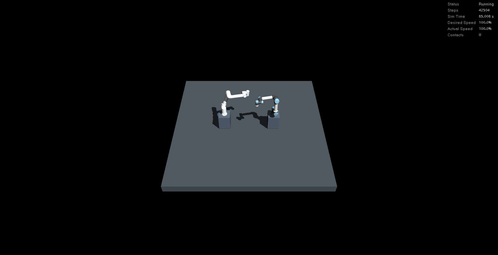
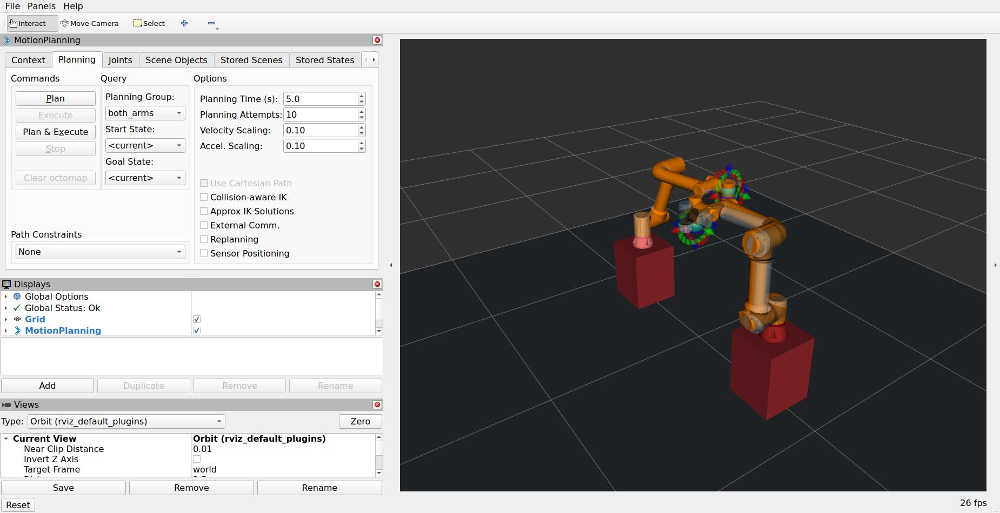

# 공동 장면의 접촉 감시·GUI·성능 검증

[공동 장면 사용법](workcells.md) · [작업 계획](plans/base_and_multi_robot.md)

## 재현 방법

네이티브 런타임의 물리 루프가 변경되므로 Python 파일 교체만으로 적용되지 않습니다.
저장소 원본에서 런타임·모델을 재빌드합니다. 기존 제조사 코드나 requirements.txt의 버전은 변경하지 않습니다.

```bash
python3 build_workspace.py --workcell fr5_ur5e
source ./manipulation_env.sh
python3 verify_scene.py --domain 103 --performance-seconds 60
python3 verify_scene.py --domain 104 --gui --stop-mode window \
  --performance-seconds 60 --screenshot-dir docs/workcells/fr5_ur5e/images
```

기존 시뮬레이터를 종료한 뒤 한 번에 한 검사만 실행합니다. 기본 성능 구간은 CI 실행 시간을 고려해 10초이며,
위 명령은 5초 준비 후 60초 동안 측정합니다. GUI 검사는 실제 X11 데스크톱·NVIDIA OpenGL·화면 수집 도구가 필요합니다.
headless CI에서는 GPU나 GUI 검사를 수행하지 않습니다.

## 물리 스텝 감시

`native/step_monitor.hpp`와 추가 런타임 패치가 초기 동기화·일반 실행·일시정지 단일 스텝의 세 경로를 감쌉니다.
각 `mj_step` 직후, 같은 물리 스레드 안에서 `mjData.contact`를 읽습니다. ROS 토픽 주기에 의존하지 않습니다.
MuJoCo가 제공하는 접촉 배열은 적분 전 동역학 평가의 결과이므로 접촉 시각과 적분 후 상태 시각을 구분합니다.
현재 공동 장면의 적분기는 `implicitfast`, 시간 간격은 0.002초입니다.

매 스텝의 접촉 수·활성 접촉 수, geom/body 쌍, 처음/마지막 접촉 시각, 최소 거리, 최대 법선 힘을 누적합니다.
`verify_scene.py`가 실행별 경로와 ID를 전달해 감시를 활성화합니다.
힘은 `mj_contactForce`의 접촉 좌표계 법선 성분입니다. 접촉 후보 중 비활성 접촉도 별도로 집계하며,
자유 공간 검증에서는 비활성 접촉을 포함해 1건이라도 발생하면 실패로 처리합니다.
[MuJoCo 접촉 정의](https://mujoco.readthedocs.io/en/stable/computation/#contact),
[힘 API](https://mujoco.readthedocs.io/en/3.4.0/APIreference/APIfunctions.html#mj-contactforce)를 참고합니다.

물리 루프에서는 디스크에 스텝별 로그를 쓰지 않습니다. 고정 크기 시간 히스토그램과 최대 256개 접촉 쌍을 집계하고,
종료 시 `physics.json`을 원자적으로 저장합니다. 한도를 넘으면 실패이며 조용히 무시하지 않습니다.
현재 공동 실행에는 [접촉 후 양팔 자동 정지](contact_stop.md)도 적용됩니다. 접촉 검출 이후 물리 상태를 고정하며,
충돌 전 예측 정지나 실제 하드웨어 안전 기능은 포함하지 않습니다.
모델의 충돌 제외 쌍, 검출 알고리즘과 유한한 시간 간격의 한계도 그대로 적용됩니다.

검증 성공에는 다음 조건을 모두 요구합니다.

- 현재 실행 ID와 컴파일된 감시 코드 SHA-256이 일치한다.
- 정상 종료한 물리 루프의 스텝 수와 감시 기록 수가 같다.
- 총 진행 시간은 `스텝 수 × timestep`과 일치하며 시간 역행·비정상 수치·기록 초과가 없다.
- 자유 공간 동작 중 접촉이 없다. 파일 누락·이전 빌드·불완전 종료도 실패다.

동작 검사 자체가 먼저 실패하면 그 오류를 보존하고, 별도 `diagnostics_error`에 물리 기록 문제를 남깁니다.
접촉 때문에 실패하더라도 접촉 쌍과 시간 정보는 결과에 보존합니다. 강제 종료로 보고서가 없으면 성공으로 판정하지 않습니다.

실제 네이티브 MuJoCo 3.12.0으로 작은 구체를 딱 한 스텝만 바닥과 겹치게 만든 시험에서,
24개 스텝 중 해당 스텝의 접촉과 힘을 탐지하고 실패 정책이 동작하는지 확인합니다.
별도의 오프라인 공동 장면 시험은 양팔 충돌 자세를 사용하며 ROS 로봇으로 해당 명령을 보내지 않습니다.

## 성능 수치의 의미

- 물리 계산 시간: 실제 네이티브 `mj_step`의 평균·최대·시간 히스토그램 상위값. 접촉·상태 검사 시간은 별도로 집계하며 히스토그램 갱신과 시계 호출의 전체 추가 비용은 별도 비교하지 않는다.
- 백분위: 10마이크로초 구간의 상한값이다. 40.96ms 이상의 꼬리 구간에 해당하면 `null`로 표시하고 초과 건수를 남긴다.
- 전체 실시간 배율: 물리 루프의 전체 진행 시간/벽시계 시간. 제어·계획 대기와 화면 수집 구간을 포함한다.
- 정상 상태 성능: 동작·취소 확인 후 정지 자세를 유지하면서 5초 준비, 지정 시간 측정. `/clock` 증가량/실제 시간으로 배율을 계산한다.
- CPU: launch 프로세스 그룹의 사용 시간 합/벽시계 시간. 1.0은 CPU 한 코어이며 검증기 자체는 제외한다.
- 메모리: 그룹 내 프로세스 RSS 합의 최대값. 공유 페이지는 중복 집계될 수 있다.
- 상태 주기: 검증기가 수신한 joint_states·clock 메시지 수/실제 시간. 제어 주기 지터와 다르다.
- 계획: 고정된 동일 시작/목표 상태에서 양팔 계획 서비스 요청 20회의 성공 수·벽시계 시간 중앙값·95백분위.
  통신 왕복 비용을 포함하고 실행은 하지 않는다. OMPL 난수 시드는 기본 설정이므로 반복 시 값이 달라질 수 있다.
- GUI: 이 실행이 생성한 MuJoCo·RViz 프로세스의 NVIDIA 사용, OpenGL 정보와 실제 클라이언트 창 스크린샷.
  FPS나 GPU 커널 시간은 측정하지 않는다. GPU 메모리는 저장된 nvidia-smi 스냅샷을 참고한다.

## 결과와 범위

측정 결과·PC 사양·실행 및 코드 해시·스크린샷 출처는 `workcell_diagnostics_validation.json`에 기록합니다.
실행별 원본 `result.json`, `physics.json`, launch 로그·GPU·OpenGL 출력은 `runtime/validation/runs/`에 보관하고 CI 아티팩트에도 포함됩니다.

PC 업그레이드 전 GTX 1050 Ti 결과와 직접 성능 비교하지 않습니다. 이번에는 업그레이드 후 동일 PC의 두 팔 headless·GUI를 비교합니다.
다른 데스크톱 앱의 부하를 완전히 통제한 전용 벤치마크는 아닙니다.
단일 팔과의 동일 조건 비교, 제어 주기 지터, 장시간 반복·FPS·영상, 시계 정지·프로세스 크래시의 실패 주입은 후속 범위입니다.
따라서 M5·M6 전체 완료로 표시하지 않습니다.

## 실측 결과 (2026-10-20, 업그레이드 후 PC)

아래 성능값은 자동 정지를 추가하기 전 `004a540` 단계의 기록입니다. 현재 정지 기능의 검증은 [별도 기록](contact_stop_validation.json)으로 구분합니다.

Intel Core i7-13700 · 메모리 약 32GB · NVIDIA RTX 3050 6GB · 드라이버 580.178.04.
두 실행은 같은 모델·설정·코드로 순차 수행했으며 실제 창을 확인했습니다.

| 항목 | Headless | MuJoCo + RViz GUI |
|---|---:|---:|
| 전체 감시 스텝 | 41,251 | 43,095 |
| 접촉 건수 | 0 | 0 |
| 60초 실시간 배율 | 1.00001 | 1.00001 |
| CPU 사용 (코어 수 환산) | 0.116 | 0.260 |
| 프로세스 RSS 합계 최대 (MiB) | 402.4 | 819.0 |
| 관절 상태 수신 (Hz) | 100.0 | 100.0 |
| 물리 스텝 평균 (µs) | 6.61 | 8.57 |
| 물리 스텝 p95 구간 상한 (µs) | 20 | 20 |
| 접촉·상태 검사 평균 (µs) | 0.060 | 0.087 |
| 양팔 계획 성공 | 20 | 20 |
| 계획 서비스 중앙값 (ms) | 17.52 | 19.01 |
| 계획 서비스 p95 (ms) | 29.00 | 21.79 |

양팔 계획은 각 모드에서 20/20회 성공했습니다. GUI GPU 스냅샷의 MuJoCo 프로세스는 141MiB,
RViz는 6MiB를 사용했습니다. 이는 해당 순간의 프로세스 GPU 메모리이며 최대 사용량은 아닙니다.
headless는 SIGINT, GUI는 창 닫기 서비스로 정상 종료했으며 자식 프로세스 잔류가 없었습니다.
단위·모델 검사 64개와 기존 FR5·FR10·UR5e·FR5 받침대의 실제 ROS 회귀 검사도 통과했습니다.

실행별 출처·정밀 수치는 [검증 기록](workcell_diagnostics_validation.json)에 있습니다.
접촉을 의도적으로 만든 두 오프라인 시험은 감지기 확인용이며 정상 동작의 접촉 0건 결과와 구분합니다.




